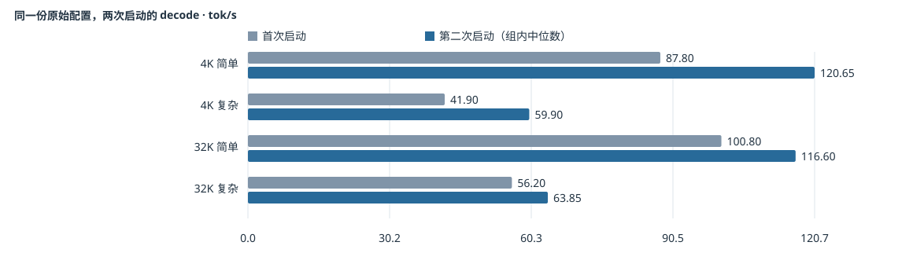
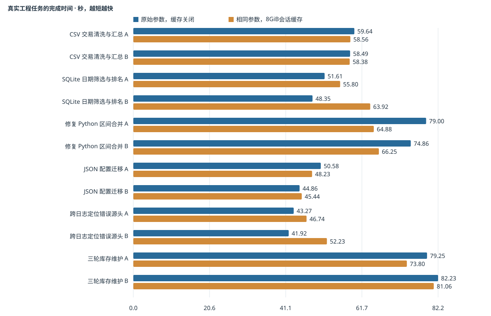

# 从引擎参数到真实 Agent：Strata / Hermes 夜间测试报告

实验于 **2026 年 10 月 20 日凌晨**完成。本版依据原始脚本、完整配置与结果文件补写实验背景、参数定义和任务细节；本文改写没有重新运行测试。

**硬件时间边界：本报告记录换回 AMD EPYC 7282 之前、双路 AMD EPYC 7452 平台上的实验。** 用户随后关机换 CPU 属于下一阶段，本文不把这些成绩当作 7282 的实测结果，也不把凌晨的健康核验当作换 CPU 后的当前在线状态。

## 1. 为什么做这轮测试，最后得到了什么

此前，我们已经解决 AS4124 的供电导致的性能异常，并比较过 worker 数、NUMA 亲和性、模型和预填充上限。新的疑问是：参考其他用户的参数后，Strata 还能否更快？单看每秒生成 token 数，是否能代表 Hermes 处理真实工具任务的效率？

本轮固定 Huihui 模型、外置 Q8_0 PLE、Strata 0.1.45、15 个 worker 与显卡顺序，先恢复显卡默认功耗，再分开考察四件事：冷输入的 prefill/decode、切换长会话后的恢复等待、Hermes 能否正确完成工程任务，以及降功耗的时间与能耗取舍。

| 问题 | 本轮观察 | 对应决策 |
|---|---|---|
| 换一组引擎参数能否稳定变快？ | 短微测未找到证据充分的胜出配置；不同启动的基准读数本身有明显波动。 | 收尾保留原始基准参数，不宣布找到全局最优。 |
| 会话缓存有没有用？ | 128K 返回会话约 53.5–53.7 秒 → 1.45–2.47 秒；普通工具任务未显示净提速。 | 把长会话恢复收益与单任务速度分开评价。 |
| 工具任务是否做对？ | 最终采用的记录中，两种配置均为 12/12；这是 6 类任务的各两次执行。 | 内部回归通过，不等同完整 BFCL 或普遍 Agent 能力证明。 |
| 180W 是否更划算？ | 32K 复杂请求中位耗时增加 8.25%，GPU 能量降低 13.06%。 | 按本次延迟优先门槛收尾恢复 250W；节能选择另看使用偏好。 |

## 2. 测试时的平台、模型与服务

| 项目 | 本轮配置 / 证据边界 |
|---|---|
| 宿主平台 | Supermicro AS4124 双路平台；当时安装 AMD EPYC 7452。此前供电问题已排除，本轮没有更换 CPU、内存或 NUMA 配置。 |
| 推理客机 | GPUServer-1，10.2.21.4；GPU 直通 Linux VM。此前实验留档为 32 vCPU / 128 GiB；当夜 final-verification 记录约 125.8 GiB 可见 RAM。15 workers 是引擎线程配置，不是 VM 的 vCPU 数。 |
| 系统和驱动 | 此前基准留档：PVE 宿主、推理 VM Debian 12 / Linux 6.1.0-53-amd64、NVIDIA 580.159.04、CUDA 13.0。本轮没有升级这些组件；夜间验收文件未重新保存完整版本快照，故这些是前期留档环境。 |
| 模型全名 | huihui-ai/Huihui-Qwen3.8-Flash-Next-abliterated-GGUF，unsloth-UD-IQ4_XS，社区 abliterated（去审查）版本。API 名称：`huihui-qwen3.8-flash-next-abliterated-ud-iq4_xs`。 |
| 模型与 PLE | 三分片 GGUF；外置 Q8_0 PLE，并用全部 native-dense 分片覆盖 dense 权重来源；本轮没有切回 SC117 IQ3。 |
| 引擎 | Strata 0.1.45；执行方案核验的源码 commit：477ac13cbe8e582c20484871ce459d20d82df09d。 |
| 文本推理显卡 | 2 × RTX 2080 Ti 22 GiB。参数筛选时每张上限 250W；功耗对照时比较每张 250W / 180W。 |
| 视觉显卡 | RTX 2070 SUPER 8 GiB，215W；视觉 token 上限 16384，threads 16。本轮没有图片请求，不能据此评价视觉速度。 |
| Agent 客户端 | Hermes-1，10.2.21.6；v0.22.1+163.g046094d；使用独立测试 home、题目工作区和 rootless Docker。 |
| 接口与并发 | `http://10.2.21.4:8080/v1/chat/completions`；串行执行。服务配置 `parallel=1`，`pipeline-windows=2`，两者不是同一个概念。 |

本报告中的“4K / 32K / 128K”表示近似输入 token 档位，实际数量以逐请求记录为准；“8192 MiB 会话缓存”表示容量预算，不是上下文 token 数。

## 3. 先把基准参数说清楚：B0、S0 和 I 是什么

**B0 = 抄参考作者参数之前的原始配置。** 本轮先把两张 2080 Ti 恢复到每张 250W，再重新测量这个配置。“B0-R2”只是同一份配置的第二次启动和复测，并不代表新参数。

**S0 = 夜间开始时线上正在使用的配置。** 它已经包含之前参考作者时加入的若干参数；本轮把它作为一个整体组合与原始配置比较。**I = 最终进入 Agent 验收的候选**，实际是 B0 加上 8192 MiB / 4 槽会话缓存。下文直接写中文配置名，代号仅用于对应文件名。

| 参数 / 项目 | 原始基准 B0 | 开始时线上组合 S0 | 最终候选 I |
|---|---|---|---|
| 模型 / 引擎 / worker | Huihui UD-IQ4_XS / 0.1.45 / 15 | 相同 | 相同 |
| `--prefill` / `--prefill-pipe` | `auto:8192` / 实际 0 | 相同 | 相同 |
| `--spec` / `--spec-min-p` | `4` / `0.50` | `4` / **`0.70`** | `4` / `0.50` |
| `--mtp-hnorm` / `--pipeline-windows` | `stream` / `2` | 相同 | 相同 |
| `--layer-split` | `auto`（由服务配置传入） | `auto` | `auto` |
| `--kv` / `--kv-resident` | `int8` / `32768` | 相同 | 相同 |
| `--max-context` / `--resident-budget-gib` | `262144` / `55` | 相同 | 相同 |
| `--ple-io` / `--expert-cache` | `ram` / `auto` | 相同 | 相同 |
| `--vram-reserve-mib` / `--vram-reserve-later-mib` | `700` / `700` | **`500` / `600`** | `700` / `700` |
| `--conversation-cache-mib` | 未显式指定；运行时确认为 **0** | 显式 `0` | **`8192`** |
| `--conversation-cache-slots` | 运行时默认 `4` | 显式 `4` | 显式 `4` |
| `STRATA_SELECT_SIMT` | 未设置 | **`2`** | 未设置 |
| `STRATA_REFILL_PARTS` / `STRATA_PREFILL_HELP` | 未设置 / 未设置 | **`1` / `1`** | 未设置 / 未设置 |
| 公共环境变量 | `STRATA_BF16_TC=1`、`STRATA_STAGE_TRIM=1`、`STRATA_SM75_PERF=1`、`STRATA_PA_V2T=1` | 相同 | 相同 |
| GPU 功耗上限（筛选 / Agent） | 每张 2080 Ti 250W | 相同 | 相同 |

表中“未设置”只说明配置文件没有显式覆盖该环境变量，不自动等于数值 0。`--spec=4` 是保存的命令行值；最终 `/metrics` 同时报告 `spec=6`、`mtp_max=4`、`lookup=3`，这些字段的含义不同，不能把运行时字段拼回另一个启动命令。

<details><summary>原始基准：完整引擎命令（根据保存配置展开；只供复现阅读）</summary>

```bash
/opt/strata/engine/strata --serve \
  --pack /data/packs/huihui-ud-iq4_xs \
  --native /data/models/huihui-ud-iq4_xs/Qwen3.8-Flash-Next-UD-IQ4_XS-00001-of-00003.gguf \
  --expert-profile /opt/strata/data/expert-profile.bin \
  --expert-cache auto \
  --prefill auto:8192 \
  --spec 4 \
  --spec-min-p 0.5 \
  --mtp /data/mtp/rt \
  --kv int8 \
  --ple-io ram \
  --kv-resident 32768 \
  --resident-budget-gib 55 \
  --vram-reserve-mib 700 \
  --max-context 262144 \
  --pool-workers 15 \
  --vram-reserve-later-mib 700 \
  --pipeline-windows 2 \
  --mtp-hnorm stream \
  --aux-cpus auto \
  --ple-gguf /data/models/Qwen3.8-Q8_0/Qwen3.8-Flash-Next-GSQ-RCO-Q8_0-PLE-00002-of-00002.gguf \
  --native-dense-gguf /data/models/huihui-ud-iq4_xs/Qwen3.8-Flash-Next-UD-IQ4_XS-00001-of-00003.gguf \
  --native-dense-gguf /data/models/huihui-ud-iq4_xs/Qwen3.8-Flash-Next-UD-IQ4_XS-00002-of-00003.gguf \
  --native-dense-gguf /data/models/huihui-ud-iq4_xs/Qwen3.8-Flash-Next-UD-IQ4_XS-00003-of-00003.gguf \
  --vision \
  --layer-split auto
```

</details>

<details><summary>原始基准：完整服务 JSON（含采样、GPU 顺序、视觉参数与模型 SHA256）</summary>

```json
{
  "exe": "/opt/strata/engine/strata",
  "args": [
    "--pack",
    "/data/packs/huihui-ud-iq4_xs",
    "--native",
    "/data/models/huihui-ud-iq4_xs/Qwen3.8-Flash-Next-UD-IQ4_XS-00001-of-00003.gguf",
    "--expert-profile",
    "/opt/strata/data/expert-profile.bin",
    "--expert-cache",
    "auto",
    "--prefill",
    "auto:8192",
    "--spec",
    "4",
    "--spec-min-p",
    "0.5",
    "--mtp",
    "/data/mtp/rt",
    "--kv",
    "int8",
    "--ple-io",
    "ram",
    "--kv-resident",
    "32768",
    "--resident-budget-gib",
    "55",
    "--vram-reserve-mib",
    "700",
    "--max-context",
    "262144",
    "--pool-workers",
    "15",
    "--vram-reserve-later-mib",
    "700",
    "--pipeline-windows",
    "2",
    "--mtp-hnorm",
    "stream",
    "--aux-cpus",
    "auto",
    "--ple-gguf",
    "/data/models/Qwen3.8-Q8_0/Qwen3.8-Flash-Next-GSQ-RCO-Q8_0-PLE-00002-of-00002.gguf",
    "--native-dense-gguf",
    "/data/models/huihui-ud-iq4_xs/Qwen3.8-Flash-Next-UD-IQ4_XS-00001-of-00003.gguf",
    "--native-dense-gguf",
    "/data/models/huihui-ud-iq4_xs/Qwen3.8-Flash-Next-UD-IQ4_XS-00002-of-00003.gguf",
    "--native-dense-gguf",
    "/data/models/huihui-ud-iq4_xs/Qwen3.8-Flash-Next-UD-IQ4_XS-00003-of-00003.gguf"
  ],
  "cwd": "/opt/strata",
  "tokenizer": "/data/packs/huihui-ud-iq4_xs/tokenizer",
  "model_name": "huihui-qwen3.8-flash-next-abliterated-ud-iq4_xs",
  "log": "/data/logs/strata-huihui-iq4-xs-q8ple-v0.1.45.log",
  "lib_dirs": [
    "/usr/local/cuda/bin",
    "/usr/local/cuda/lib64"
  ],
  "port": 8080,
  "gpu": [
    1,
    2
  ],
  "gpus_asked": true,
  "layer_split": "auto",
  "host": "0.0.0.0",
  "open_browser": false,
  "parallel": 1,
  "deployment_model_manifest": {
    "repo": "huihui-ai/Huihui-Qwen3.8-Flash-Next-abliterated-GGUF",
    "files": [
      {
        "path": "unsloth-UD-IQ4_XS/Qwen3.8-Flash-Next-UD-IQ4_XS-00001-of-00003.gguf",
        "size": 10946624,
        "sha256": "5ce89370720f8bf90890f439361282104c1aa1482d4013bb9a50923e758e71a4"
      },
      {
        "path": "unsloth-UD-IQ4_XS/Qwen3.8-Flash-Next-UD-IQ4_XS-00002-of-00003.gguf",
        "size": 49835229856,
        "sha256": "c67b468b3b83bc12a987e455ec4a0c2c3937250da1c234ae1638d9505180c161"
      },
      {
        "path": "unsloth-UD-IQ4_XS/Qwen3.8-Flash-Next-UD-IQ4_XS-00003-of-00003.gguf",
        "size": 43836407744,
        "sha256": "130560b6a447e0febf61de9b03476f52143160bc4bcbacc9bfa07d9538718e2c"
      }
    ],
    "revision": "06a318de4011598a142ee54bcfec47c6921c958e",
    "external_ple_type": "Q8_0",
    "external_ple_path": "/opt/strata-data/models/Qwen3.8-Q8_0/Qwen3.8-Flash-Next-GSQ-RCO-Q8_0-PLE-00002-of-00002.gguf",
    "runtime_parameters": "Current SC117 0.1.45 parameter set retained, with model-specific pack, native, MTP, tokenizer, vision paths and dense-GGUF override replaced."
  },
  "reasoning_effort": "high",
  "reasoning_budget_tokens": 32768,
  "repeat_stop_tokens": 256,
  "sampling": {
    "temperature": 1.0,
    "top_p": 0.95,
    "top_k": 20,
    "min_p": 0.0,
    "presence_penalty": 0.0,
    "repetition_penalty": 1.0
  },
  "allowed_hosts": [
    "10.2.21.4"
  ],
  "env": {
    "STRATA_BF16_TC": "1",
    "STRATA_STAGE_TRIM": "1",
    "CUDA_VISIBLE_DEVICES": "GPU-be897daa-b730-b812-cac5-0677e7c00d5b,GPU-9a371e9d-99d5-eb30-e2f1-1a8cef3b6f03",
    "STRATA_SM75_PERF": "1",
    "STRATA_PA_V2T": "1"
  },
  "aliases": [
    "huihui-qwen3.8-flash-next-abliterated-ud-iq4_xs"
  ],
  "gpu_order": "as_given",
  "vision": {
    "exe": "/opt/strata/engine/strata-vision",
    "mmproj": "/data/models/vision/mmproj-Qwen3.8-Flash-Next-BF16.gguf",
    "model": "/data/models/huihui-ud-iq4_xs/Qwen3.8-Flash-Next-UD-IQ4_XS-00001-of-00003.gguf",
    "gpu": true,
    "cuda_device": "GPU-05e5166d-a213-14af-16ec-886fa9cb51f4",
    "max_tokens": 16384,
    "threads": 16
  }
}
```

</details>

<details><summary>测试结束时的真实进程命令与环境</summary>

```text
236535 /opt/strata/engine/strata --serve --pack /data/packs/huihui-ud-iq4_xs --native /data/models/huihui-ud-iq4_xs/Qwen3.8-Flash-Next-UD-IQ4_XS-00001-of-00003.gguf --expert-profile /opt/strata/data/expert-profile.bin --expert-cache auto --prefill auto:8192 --spec 4 --spec-min-p 0.5 --mtp /data/mtp/rt --kv int8 --ple-io ram --kv-resident 32768 --resident-budget-gib 55 --vram-reserve-mib 700 --max-context 262144 --pool-workers 15 --vram-reserve-later-mib 700 --pipeline-windows 2 --mtp-hnorm stream --aux-cpus auto --ple-gguf /data/models/Qwen3.8-Q8_0/Qwen3.8-Flash-Next-GSQ-RCO-Q8_0-PLE-00002-of-00002.gguf --native-dense-gguf /data/models/huihui-ud-iq4_xs/Qwen3.8-Flash-Next-UD-IQ4_XS-00001-of-00003.gguf --native-dense-gguf /data/models/huihui-ud-iq4_xs/Qwen3.8-Flash-Next-UD-IQ4_XS-00002-of-00003.gguf --native-dense-gguf /data/models/huihui-ud-iq4_xs/Qwen3.8-Flash-Next-UD-IQ4_XS-00003-of-00003.gguf --vision --layer-split auto

{
  "STRATA_ROUTE_TAIL_SKIP": "0",
  "STRATA_EXECV": "1",
  "STRATA_SOURCE": "modelscope",
  "STRATA_REQUEST_LINES": "1",
  "CUDA_VISIBLE_DEVICES": "GPU-be897daa-b730-b812-cac5-0677e7c00d5b,GPU-9a371e9d-99d5-eb30-e2f1-1a8cef3b6f03",
  "STRATA_BF16_TC": "1",
  "STRATA_STAGE_TRIM": "1",
  "STRATA_SM75_PERF": "1",
  "STRATA_PA_V2T": "1"
}
```

</details>

完整 JSON 还保留服务默认采样：temperature 1.0、top_p 0.95、top_k 20、min_p 0；服务默认 reasoning_effort 为 high、预算 32768。下节会分别列出微测与 Hermes 的设置，不能把这些服务默认值当成所有请求的实际采样值。

## 4. 四类测试分别怎么测，哪些成绩可以比较

| 协议 | 测试内容 | 预热与重复（实际执行） | 计时 / 判分来源 |
|---|---|---|---|
| 引擎冷请求微测 | 4K 简单、4K 复杂、32K 简单、32K 复杂；每个请求最多输出 512 token。 | 每个参数组重建引擎；一次 4K 简单请求预热，最多输出 64 token。大多每题 1 次，部分组 2 次；组别明细见第 5 节。 | 自写 run_micro_arm.py；prefill/decode 取 Strata `/metrics`，流式首输出和总耗时由客户端记录。本轮不是 EvalScope。 |
| 会话切换恢复 | 在 32K、128K 输入档位执行 A → B → A → B；同一侧返回时输入保持一致，最多输出 16 token。 | 分别比较缓存 0 与 8192 MiB / 4 槽。每个长度两次返回请求；32K 开启组有归档缺口，单独标注。 | 自写 cache_probe.py；客户端整请求耗时，以及引擎 reused / prompt_total / cache 统计。 |
| Hermes 工程任务 | 6 类任务 × A/B 两次执行；真实 terminal/file 工具循环；T6 包含 3 轮用户要求。 | 每题独立工作区与 Hermes home；T6 内续接同一个 session。受题目修订影响，最终表由指定复测记录合成。 | nightly_suite.py 的外层 subprocess 墙钟；控制器读取产物、运行隐藏测试、检查原始文件哈希。 |
| GPU 功耗对照 | 同一 32K 复杂请求，最多输出 512 token；只改变两张文本 GPU 的功耗上限。 | 250、180、180、250、250、180W；每档 3 次。切换后等待 5 秒，并先发一次 64 token 预热请求；不重启引擎。 | 自写 power_compare.py；客户端墙钟和引擎速度；流式读取期间从 `/metrics` 采集 GPU 功率，分段积分得到能量。 |

### 冷请求的简单文本与复杂文本究竟是什么

两种请求都读取同一来源的口腔临床记录材料，正文按输入档位裁切。简单任务要求“从 1 开始逐行数到 1000”；复杂任务要求分析“口腔临床记录中信息完整性与可追溯性的关系、记录偏差环节和改进建议”。后者用于观察非重复自然语言输出，不能把两者的 decode 平均当成统一工作负载。

微测从 `outputs/numa-affinity-sweep-20261019/requests.jsonl` 复用固定正文；请求 temperature=0、top_p=0.95、top_k=20、seed=20261019、reasoning_effort=none。脚本把输出上限由原请求的 1000 改为 512，并在开头加上参数组/轮次标记以避免前缀复用。不同组标记不同，因此输入正文相同但并非逐字节完全相同；表中保留实际输入 token 与 `reused`。

<details><summary>冷请求：请求字段及两个任务的原始末尾指令</summary>

```text
{
  "max_tokens": 512,
  "temperature": 0,
  "top_p": 0.95,
  "top_k": 20,
  "seed": 20261019,
  "reasoning_effort": "none",
  "stream": true,
  "stream_options": {
    "include_usage": true
  }
}

简单任务：
请从 1 开始逐行数到 1000，每行只写一个阿拉伯数字，不要解释，不要复述材料，不要加标题。

复杂任务：
请综合材料内容，分析口腔临床记录中信息完整性与可追溯性的关系，说明可能造成记录偏差的环节，并给出可执行的改进建议。用中文分点回答，结论明确，避免无依据扩展。
```

</details>

### 三个时间指标不能混用

| 指标 | 本报告的定义 |
|---|---|
| prefill tok/s | 微测使用引擎 prompt_tokens ÷ (prompt_ms / 1000)。冷请求已检查 reused=0；不套用于命中缓存的恢复请求。 |
| decode tok/s | 直接采用引擎逐请求的 decode_tok_s。它反映生成阶段，不能替代用户等待整项任务的时间。 |
| 首输出 / TTFT | 客户端收到第一个包含 content 或 reasoning_content 的流事件；脚本另存首个可见 content。两者均不等于完整工具调用已生成。 |
| Agent 总耗时 | 一题中 Hermes CLI 子进程耗时之和，包含客户端启动、工具与模型交互；不包含输入生成和最后判分耗时。T6 为三轮之和。 |
| 128K 返回会话耗时 | 非流式请求的完整返回时间，含最多 16 token 输出；它不是严格意义上的 TTFT。 |

本轮没有为每道 Agent 题归档一份完整的逐模型请求 prefill/decode 汇总；因此 Agent 结果只报告可核验的任务耗时、工具次数和正确性。我们不从 Agent 总时间倒推某个未测到的 prefill 或 decode。

## 5. 每组到底改了什么：完整实验矩阵

下面先列参数，再看成绩。**除了原始基准与 S0，后续 MTP、prefill-pipe、阈值候选都继承了开启会话缓存的配置。** 因而它们与原始基准的差异包含缓存；例如 PIPE1536 对“缓存候选”的比较才接近单变量对照，不能把它对 B0 的全部差异归给 prefill-pipe。

| 中文名称 / 归档代号 | 继承哪份配置 | 本组显式改变 | 测量数量 | 证据级别 |
|---|---|---|---|---|
| 原始基准 · 首次启动<br>`B0` | 原始基准 B0 | 无参数变化；独立启动后每题测1次 | 每题 1 次，共 4 条 | 仅初筛，无完整3对交错复测 |
| 原始基准 · 第二次启动<br>`B0-R2` | 原始基准 B0 | 无参数变化；独立启动后每题复测2次 | 每题 2 次，共 8 条 | 仅初筛，无完整3对交错复测 |
| 测试开始时的线上参数组合<br>`S0` | 开始时线上配置 | spec-min-p=0.70；显存预留500/600；SELECT_SIMT=2；REFILL_PARTS=1；PREFILL_HELP=1 | 每题 1 次，共 4 条 | 仅初筛，无完整3对交错复测 |
| 原始基准 + 8 GiB 会话缓存（最终候选）<br>`CACHE8192` | 原始基准 B0 | --conversation-cache-mib=8192；--conversation-cache-slots=4 | 每题 1 次，共 4 条 | 仅初筛，无完整3对交错复测 |
| 缓存配置 + MTP batch 开关<br>`L1-SPLITMTP` | B0 + 8 GiB / 4 槽缓存 | STRATA_SPLIT_MTP_BATCH=1 | 每题 2 次，共 8 条 | 开关存在，但未获得 batched-path 生效确认 |
| MTP batch 开关 · 生效复查<br>`L1-verify` | B0 + 8 GiB / 4 槽缓存 | STRATA_SPLIT_MTP_BATCH=1 | 每题 1 次，共 4 条 | 开关存在，但未获得 batched-path 生效确认 |
| 缓存配置 + 显式指定后卡（即默认）<br>`L0-FORCE-SECOND` | B0 + 8 GiB / 4 槽缓存 | STRATA_MTP_STAGE0=0 | 每题 1 次，共 4 条 | 仅初筛，无完整3对交错复测 |
| 显式后卡（默认）+ MTP batch 开关<br>`L1-FORCE-SECOND-SPLIT` | B0 + 8 GiB / 4 槽缓存 | STRATA_MTP_STAGE0=0；STRATA_SPLIT_MTP_BATCH=1 | 每题 1 次，共 4 条 | 开关存在，但未获得 batched-path 生效确认 |
| 缓存配置 + 将 MTP 草稿层移到首卡<br>`L2-MTPSTAGE0` | B0 + 8 GiB / 4 槽缓存 | STRATA_MTP_STAGE0=1 | 每题 2 次，共 8 条 | 真正移到首卡；四格两升两降，未形成稳定方向 |
| 缓存配置 + prefill-pipe=1<br>`PIPE1` | B0 + 8 GiB / 4 槽缓存 | --prefill-pipe=1 | 每题 1 次，共 4 条 | 仅初筛，无完整3对交错复测 |
| 缓存配置 + prefill-pipe=1536<br>`PIPE1536` | B0 + 8 GiB / 4 槽缓存 | --prefill-pipe=1536 | 每题 1 次，共 4 条 | 仅初筛，无完整3对交错复测 |
| 缓存配置 + prefill-pipe=6144<br>`PIPE6144` | B0 + 8 GiB / 4 槽缓存 | --prefill-pipe=6144 | 每题 1 次，共 4 条 | 仅初筛，无完整3对交错复测 |
| 缓存配置 + spec-min-p=0.30<br>`SPEC30` | B0 + 8 GiB / 4 槽缓存 | --spec-min-p=0.30 | 每题 1 次，共 4 条 | 仅初筛，无完整3对交错复测 |
| 缓存配置 + spec-min-p=0.70<br>`SPEC70` | B0 + 8 GiB / 4 槽缓存 | --spec-min-p=0.70 | 每题 1 次，共 4 条 | 仅初筛，无完整3对交错复测 |

prefill-pipe 的数值按引擎参数原样记录，不把 1536/6144 解释成实际处理的 chunk token 数。MTP batch 未确认生效的组既不能证明该优化有用，也不能证明该优化无效。

<details><summary>原始基准 · 首次启动（B0）：完整命令与全部显式环境变量</summary>

```text
/opt/strata/engine/strata --serve \
  --pack /data/packs/huihui-ud-iq4_xs \
  --native /data/models/huihui-ud-iq4_xs/Qwen3.8-Flash-Next-UD-IQ4_XS-00001-of-00003.gguf \
  --expert-profile /opt/strata/data/expert-profile.bin \
  --expert-cache auto \
  --prefill auto:8192 \
  --spec 4 \
  --spec-min-p 0.5 \
  --mtp /data/mtp/rt \
  --kv int8 \
  --ple-io ram \
  --kv-resident 32768 \
  --resident-budget-gib 55 \
  --vram-reserve-mib 700 \
  --max-context 262144 \
  --pool-workers 15 \
  --vram-reserve-later-mib 700 \
  --pipeline-windows 2 \
  --mtp-hnorm stream \
  --aux-cpus auto \
  --ple-gguf /data/models/Qwen3.8-Q8_0/Qwen3.8-Flash-Next-GSQ-RCO-Q8_0-PLE-00002-of-00002.gguf \
  --native-dense-gguf /data/models/huihui-ud-iq4_xs/Qwen3.8-Flash-Next-UD-IQ4_XS-00001-of-00003.gguf \
  --native-dense-gguf /data/models/huihui-ud-iq4_xs/Qwen3.8-Flash-Next-UD-IQ4_XS-00002-of-00003.gguf \
  --native-dense-gguf /data/models/huihui-ud-iq4_xs/Qwen3.8-Flash-Next-UD-IQ4_XS-00003-of-00003.gguf \
  --vision \
  --layer-split auto

# 配置中显式设置的环境变量
{
  "STRATA_BF16_TC": "1",
  "STRATA_STAGE_TRIM": "1",
  "CUDA_VISIBLE_DEVICES": "GPU-be897daa-b730-b812-cac5-0677e7c00d5b,GPU-9a371e9d-99d5-eb30-e2f1-1a8cef3b6f03",
  "STRATA_SM75_PERF": "1",
  "STRATA_PA_V2T": "1"
}
```

</details>

<details><summary>原始基准 · 第二次启动（B0-R2）：完整命令与全部显式环境变量</summary>

```text
/opt/strata/engine/strata --serve \
  --pack /data/packs/huihui-ud-iq4_xs \
  --native /data/models/huihui-ud-iq4_xs/Qwen3.8-Flash-Next-UD-IQ4_XS-00001-of-00003.gguf \
  --expert-profile /opt/strata/data/expert-profile.bin \
  --expert-cache auto \
  --prefill auto:8192 \
  --spec 4 \
  --spec-min-p 0.5 \
  --mtp /data/mtp/rt \
  --kv int8 \
  --ple-io ram \
  --kv-resident 32768 \
  --resident-budget-gib 55 \
  --vram-reserve-mib 700 \
  --max-context 262144 \
  --pool-workers 15 \
  --vram-reserve-later-mib 700 \
  --pipeline-windows 2 \
  --mtp-hnorm stream \
  --aux-cpus auto \
  --ple-gguf /data/models/Qwen3.8-Q8_0/Qwen3.8-Flash-Next-GSQ-RCO-Q8_0-PLE-00002-of-00002.gguf \
  --native-dense-gguf /data/models/huihui-ud-iq4_xs/Qwen3.8-Flash-Next-UD-IQ4_XS-00001-of-00003.gguf \
  --native-dense-gguf /data/models/huihui-ud-iq4_xs/Qwen3.8-Flash-Next-UD-IQ4_XS-00002-of-00003.gguf \
  --native-dense-gguf /data/models/huihui-ud-iq4_xs/Qwen3.8-Flash-Next-UD-IQ4_XS-00003-of-00003.gguf \
  --vision \
  --layer-split auto

# 配置中显式设置的环境变量
{
  "STRATA_BF16_TC": "1",
  "STRATA_STAGE_TRIM": "1",
  "CUDA_VISIBLE_DEVICES": "GPU-be897daa-b730-b812-cac5-0677e7c00d5b,GPU-9a371e9d-99d5-eb30-e2f1-1a8cef3b6f03",
  "STRATA_SM75_PERF": "1",
  "STRATA_PA_V2T": "1"
}
```

</details>

<details><summary>测试开始时的线上参数组合（S0）：完整命令与全部显式环境变量</summary>

```text
/opt/strata/engine/strata --serve \
  --pack /data/packs/huihui-ud-iq4_xs \
  --native /data/models/huihui-ud-iq4_xs/Qwen3.8-Flash-Next-UD-IQ4_XS-00001-of-00003.gguf \
  --expert-profile /opt/strata/data/expert-profile.bin \
  --expert-cache auto \
  --prefill auto:8192 \
  --spec 4 \
  --spec-min-p 0.70 \
  --mtp /data/mtp/rt \
  --kv int8 \
  --ple-io ram \
  --kv-resident 32768 \
  --resident-budget-gib 55 \
  --vram-reserve-mib 500 \
  --max-context 262144 \
  --pool-workers 15 \
  --vram-reserve-later-mib 600 \
  --pipeline-windows 2 \
  --mtp-hnorm stream \
  --aux-cpus auto \
  --ple-gguf /data/models/Qwen3.8-Q8_0/Qwen3.8-Flash-Next-GSQ-RCO-Q8_0-PLE-00002-of-00002.gguf \
  --native-dense-gguf /data/models/huihui-ud-iq4_xs/Qwen3.8-Flash-Next-UD-IQ4_XS-00001-of-00003.gguf \
  --native-dense-gguf /data/models/huihui-ud-iq4_xs/Qwen3.8-Flash-Next-UD-IQ4_XS-00002-of-00003.gguf \
  --native-dense-gguf /data/models/huihui-ud-iq4_xs/Qwen3.8-Flash-Next-UD-IQ4_XS-00003-of-00003.gguf \
  --layer-split auto \
  --conversation-cache-mib 0 \
  --conversation-cache-slots 4 \
  --vision

# 配置中显式设置的环境变量
{
  "STRATA_BF16_TC": "1",
  "STRATA_STAGE_TRIM": "1",
  "CUDA_VISIBLE_DEVICES": "GPU-be897daa-b730-b812-cac5-0677e7c00d5b,GPU-9a371e9d-99d5-eb30-e2f1-1a8cef3b6f03",
  "STRATA_SM75_PERF": "1",
  "STRATA_PA_V2T": "1",
  "STRATA_SELECT_SIMT": "2",
  "STRATA_REFILL_PARTS": "1",
  "STRATA_PREFILL_HELP": "1"
}
```

</details>

<details><summary>原始基准 + 8 GiB 会话缓存（最终候选）（CACHE8192）：完整命令与全部显式环境变量</summary>

```text
/opt/strata/engine/strata --serve \
  --pack /data/packs/huihui-ud-iq4_xs \
  --native /data/models/huihui-ud-iq4_xs/Qwen3.8-Flash-Next-UD-IQ4_XS-00001-of-00003.gguf \
  --expert-profile /opt/strata/data/expert-profile.bin \
  --expert-cache auto \
  --prefill auto:8192 \
  --spec 4 \
  --spec-min-p 0.5 \
  --mtp /data/mtp/rt \
  --kv int8 \
  --ple-io ram \
  --kv-resident 32768 \
  --resident-budget-gib 55 \
  --vram-reserve-mib 700 \
  --max-context 262144 \
  --pool-workers 15 \
  --vram-reserve-later-mib 700 \
  --pipeline-windows 2 \
  --mtp-hnorm stream \
  --aux-cpus auto \
  --ple-gguf /data/models/Qwen3.8-Q8_0/Qwen3.8-Flash-Next-GSQ-RCO-Q8_0-PLE-00002-of-00002.gguf \
  --native-dense-gguf /data/models/huihui-ud-iq4_xs/Qwen3.8-Flash-Next-UD-IQ4_XS-00001-of-00003.gguf \
  --native-dense-gguf /data/models/huihui-ud-iq4_xs/Qwen3.8-Flash-Next-UD-IQ4_XS-00002-of-00003.gguf \
  --native-dense-gguf /data/models/huihui-ud-iq4_xs/Qwen3.8-Flash-Next-UD-IQ4_XS-00003-of-00003.gguf \
  --conversation-cache-mib 8192 \
  --conversation-cache-slots 4 \
  --vision \
  --layer-split auto

# 配置中显式设置的环境变量
{
  "STRATA_BF16_TC": "1",
  "STRATA_STAGE_TRIM": "1",
  "CUDA_VISIBLE_DEVICES": "GPU-be897daa-b730-b812-cac5-0677e7c00d5b,GPU-9a371e9d-99d5-eb30-e2f1-1a8cef3b6f03",
  "STRATA_SM75_PERF": "1",
  "STRATA_PA_V2T": "1"
}
```

</details>

<details><summary>缓存配置 + MTP batch 开关（L1-SPLITMTP）：完整命令与全部显式环境变量</summary>

```text
/opt/strata/engine/strata --serve \
  --pack /data/packs/huihui-ud-iq4_xs \
  --native /data/models/huihui-ud-iq4_xs/Qwen3.8-Flash-Next-UD-IQ4_XS-00001-of-00003.gguf \
  --expert-profile /opt/strata/data/expert-profile.bin \
  --expert-cache auto \
  --prefill auto:8192 \
  --spec 4 \
  --spec-min-p 0.5 \
  --mtp /data/mtp/rt \
  --kv int8 \
  --ple-io ram \
  --kv-resident 32768 \
  --resident-budget-gib 55 \
  --vram-reserve-mib 700 \
  --max-context 262144 \
  --pool-workers 15 \
  --vram-reserve-later-mib 700 \
  --pipeline-windows 2 \
  --mtp-hnorm stream \
  --aux-cpus auto \
  --ple-gguf /data/models/Qwen3.8-Q8_0/Qwen3.8-Flash-Next-GSQ-RCO-Q8_0-PLE-00002-of-00002.gguf \
  --native-dense-gguf /data/models/huihui-ud-iq4_xs/Qwen3.8-Flash-Next-UD-IQ4_XS-00001-of-00003.gguf \
  --native-dense-gguf /data/models/huihui-ud-iq4_xs/Qwen3.8-Flash-Next-UD-IQ4_XS-00002-of-00003.gguf \
  --native-dense-gguf /data/models/huihui-ud-iq4_xs/Qwen3.8-Flash-Next-UD-IQ4_XS-00003-of-00003.gguf \
  --conversation-cache-mib 8192 \
  --conversation-cache-slots 4 \
  --vision \
  --layer-split auto

# 配置中显式设置的环境变量
{
  "STRATA_BF16_TC": "1",
  "STRATA_STAGE_TRIM": "1",
  "CUDA_VISIBLE_DEVICES": "GPU-be897daa-b730-b812-cac5-0677e7c00d5b,GPU-9a371e9d-99d5-eb30-e2f1-1a8cef3b6f03",
  "STRATA_SM75_PERF": "1",
  "STRATA_PA_V2T": "1",
  "STRATA_SPLIT_MTP_BATCH": "1"
}
```

</details>

<details><summary>MTP batch 开关 · 生效复查（L1-verify）：完整命令与全部显式环境变量</summary>

```text
/opt/strata/engine/strata --serve \
  --pack /data/packs/huihui-ud-iq4_xs \
  --native /data/models/huihui-ud-iq4_xs/Qwen3.8-Flash-Next-UD-IQ4_XS-00001-of-00003.gguf \
  --expert-profile /opt/strata/data/expert-profile.bin \
  --expert-cache auto \
  --prefill auto:8192 \
  --spec 4 \
  --spec-min-p 0.5 \
  --mtp /data/mtp/rt \
  --kv int8 \
  --ple-io ram \
  --kv-resident 32768 \
  --resident-budget-gib 55 \
  --vram-reserve-mib 700 \
  --max-context 262144 \
  --pool-workers 15 \
  --vram-reserve-later-mib 700 \
  --pipeline-windows 2 \
  --mtp-hnorm stream \
  --aux-cpus auto \
  --ple-gguf /data/models/Qwen3.8-Q8_0/Qwen3.8-Flash-Next-GSQ-RCO-Q8_0-PLE-00002-of-00002.gguf \
  --native-dense-gguf /data/models/huihui-ud-iq4_xs/Qwen3.8-Flash-Next-UD-IQ4_XS-00001-of-00003.gguf \
  --native-dense-gguf /data/models/huihui-ud-iq4_xs/Qwen3.8-Flash-Next-UD-IQ4_XS-00002-of-00003.gguf \
  --native-dense-gguf /data/models/huihui-ud-iq4_xs/Qwen3.8-Flash-Next-UD-IQ4_XS-00003-of-00003.gguf \
  --conversation-cache-mib 8192 \
  --conversation-cache-slots 4 \
  --vision \
  --layer-split auto

# 配置中显式设置的环境变量
{
  "STRATA_BF16_TC": "1",
  "STRATA_STAGE_TRIM": "1",
  "CUDA_VISIBLE_DEVICES": "GPU-be897daa-b730-b812-cac5-0677e7c00d5b,GPU-9a371e9d-99d5-eb30-e2f1-1a8cef3b6f03",
  "STRATA_SM75_PERF": "1",
  "STRATA_PA_V2T": "1",
  "STRATA_SPLIT_MTP_BATCH": "1"
}
```

</details>

<details><summary>缓存配置 + 显式指定后卡（即默认）（L0-FORCE-SECOND）：完整命令与全部显式环境变量</summary>

```text
/opt/strata/engine/strata --serve \
  --pack /data/packs/huihui-ud-iq4_xs \
  --native /data/models/huihui-ud-iq4_xs/Qwen3.8-Flash-Next-UD-IQ4_XS-00001-of-00003.gguf \
  --expert-profile /opt/strata/data/expert-profile.bin \
  --expert-cache auto \
  --prefill auto:8192 \
  --spec 4 \
  --spec-min-p 0.5 \
  --mtp /data/mtp/rt \
  --kv int8 \
  --ple-io ram \
  --kv-resident 32768 \
  --resident-budget-gib 55 \
  --vram-reserve-mib 700 \
  --max-context 262144 \
  --pool-workers 15 \
  --vram-reserve-later-mib 700 \
  --pipeline-windows 2 \
  --mtp-hnorm stream \
  --aux-cpus auto \
  --ple-gguf /data/models/Qwen3.8-Q8_0/Qwen3.8-Flash-Next-GSQ-RCO-Q8_0-PLE-00002-of-00002.gguf \
  --native-dense-gguf /data/models/huihui-ud-iq4_xs/Qwen3.8-Flash-Next-UD-IQ4_XS-00001-of-00003.gguf \
  --native-dense-gguf /data/models/huihui-ud-iq4_xs/Qwen3.8-Flash-Next-UD-IQ4_XS-00002-of-00003.gguf \
  --native-dense-gguf /data/models/huihui-ud-iq4_xs/Qwen3.8-Flash-Next-UD-IQ4_XS-00003-of-00003.gguf \
  --conversation-cache-mib 8192 \
  --conversation-cache-slots 4 \
  --vision \
  --layer-split auto

# 配置中显式设置的环境变量
{
  "STRATA_BF16_TC": "1",
  "STRATA_STAGE_TRIM": "1",
  "CUDA_VISIBLE_DEVICES": "GPU-be897daa-b730-b812-cac5-0677e7c00d5b,GPU-9a371e9d-99d5-eb30-e2f1-1a8cef3b6f03",
  "STRATA_SM75_PERF": "1",
  "STRATA_PA_V2T": "1",
  "STRATA_MTP_STAGE0": "0"
}
```

</details>

<details><summary>显式后卡（默认）+ MTP batch 开关（L1-FORCE-SECOND-SPLIT）：完整命令与全部显式环境变量</summary>

```text
/opt/strata/engine/strata --serve \
  --pack /data/packs/huihui-ud-iq4_xs \
  --native /data/models/huihui-ud-iq4_xs/Qwen3.8-Flash-Next-UD-IQ4_XS-00001-of-00003.gguf \
  --expert-profile /opt/strata/data/expert-profile.bin \
  --expert-cache auto \
  --prefill auto:8192 \
  --spec 4 \
  --spec-min-p 0.5 \
  --mtp /data/mtp/rt \
  --kv int8 \
  --ple-io ram \
  --kv-resident 32768 \
  --resident-budget-gib 55 \
  --vram-reserve-mib 700 \
  --max-context 262144 \
  --pool-workers 15 \
  --vram-reserve-later-mib 700 \
  --pipeline-windows 2 \
  --mtp-hnorm stream \
  --aux-cpus auto \
  --ple-gguf /data/models/Qwen3.8-Q8_0/Qwen3.8-Flash-Next-GSQ-RCO-Q8_0-PLE-00002-of-00002.gguf \
  --native-dense-gguf /data/models/huihui-ud-iq4_xs/Qwen3.8-Flash-Next-UD-IQ4_XS-00001-of-00003.gguf \
  --native-dense-gguf /data/models/huihui-ud-iq4_xs/Qwen3.8-Flash-Next-UD-IQ4_XS-00002-of-00003.gguf \
  --native-dense-gguf /data/models/huihui-ud-iq4_xs/Qwen3.8-Flash-Next-UD-IQ4_XS-00003-of-00003.gguf \
  --conversation-cache-mib 8192 \
  --conversation-cache-slots 4 \
  --vision \
  --layer-split auto

# 配置中显式设置的环境变量
{
  "STRATA_BF16_TC": "1",
  "STRATA_STAGE_TRIM": "1",
  "CUDA_VISIBLE_DEVICES": "GPU-be897daa-b730-b812-cac5-0677e7c00d5b,GPU-9a371e9d-99d5-eb30-e2f1-1a8cef3b6f03",
  "STRATA_SM75_PERF": "1",
  "STRATA_PA_V2T": "1",
  "STRATA_MTP_STAGE0": "0",
  "STRATA_SPLIT_MTP_BATCH": "1"
}
```

</details>

<details><summary>缓存配置 + 将 MTP 草稿层移到首卡（L2-MTPSTAGE0）：完整命令与全部显式环境变量</summary>

```text
/opt/strata/engine/strata --serve \
  --pack /data/packs/huihui-ud-iq4_xs \
  --native /data/models/huihui-ud-iq4_xs/Qwen3.8-Flash-Next-UD-IQ4_XS-00001-of-00003.gguf \
  --expert-profile /opt/strata/data/expert-profile.bin \
  --expert-cache auto \
  --prefill auto:8192 \
  --spec 4 \
  --spec-min-p 0.5 \
  --mtp /data/mtp/rt \
  --kv int8 \
  --ple-io ram \
  --kv-resident 32768 \
  --resident-budget-gib 55 \
  --vram-reserve-mib 700 \
  --max-context 262144 \
  --pool-workers 15 \
  --vram-reserve-later-mib 700 \
  --pipeline-windows 2 \
  --mtp-hnorm stream \
  --aux-cpus auto \
  --ple-gguf /data/models/Qwen3.8-Q8_0/Qwen3.8-Flash-Next-GSQ-RCO-Q8_0-PLE-00002-of-00002.gguf \
  --native-dense-gguf /data/models/huihui-ud-iq4_xs/Qwen3.8-Flash-Next-UD-IQ4_XS-00001-of-00003.gguf \
  --native-dense-gguf /data/models/huihui-ud-iq4_xs/Qwen3.8-Flash-Next-UD-IQ4_XS-00002-of-00003.gguf \
  --native-dense-gguf /data/models/huihui-ud-iq4_xs/Qwen3.8-Flash-Next-UD-IQ4_XS-00003-of-00003.gguf \
  --conversation-cache-mib 8192 \
  --conversation-cache-slots 4 \
  --vision \
  --layer-split auto

# 配置中显式设置的环境变量
{
  "STRATA_BF16_TC": "1",
  "STRATA_STAGE_TRIM": "1",
  "CUDA_VISIBLE_DEVICES": "GPU-be897daa-b730-b812-cac5-0677e7c00d5b,GPU-9a371e9d-99d5-eb30-e2f1-1a8cef3b6f03",
  "STRATA_SM75_PERF": "1",
  "STRATA_PA_V2T": "1",
  "STRATA_MTP_STAGE0": "1"
}
```

</details>

<details><summary>缓存配置 + prefill-pipe=1（PIPE1）：完整命令与全部显式环境变量</summary>

```text
/opt/strata/engine/strata --serve \
  --pack /data/packs/huihui-ud-iq4_xs \
  --native /data/models/huihui-ud-iq4_xs/Qwen3.8-Flash-Next-UD-IQ4_XS-00001-of-00003.gguf \
  --expert-profile /opt/strata/data/expert-profile.bin \
  --expert-cache auto \
  --prefill auto:8192 \
  --spec 4 \
  --spec-min-p 0.5 \
  --mtp /data/mtp/rt \
  --kv int8 \
  --ple-io ram \
  --kv-resident 32768 \
  --resident-budget-gib 55 \
  --vram-reserve-mib 700 \
  --max-context 262144 \
  --pool-workers 15 \
  --vram-reserve-later-mib 700 \
  --pipeline-windows 2 \
  --mtp-hnorm stream \
  --aux-cpus auto \
  --ple-gguf /data/models/Qwen3.8-Q8_0/Qwen3.8-Flash-Next-GSQ-RCO-Q8_0-PLE-00002-of-00002.gguf \
  --native-dense-gguf /data/models/huihui-ud-iq4_xs/Qwen3.8-Flash-Next-UD-IQ4_XS-00001-of-00003.gguf \
  --native-dense-gguf /data/models/huihui-ud-iq4_xs/Qwen3.8-Flash-Next-UD-IQ4_XS-00002-of-00003.gguf \
  --native-dense-gguf /data/models/huihui-ud-iq4_xs/Qwen3.8-Flash-Next-UD-IQ4_XS-00003-of-00003.gguf \
  --conversation-cache-mib 8192 \
  --conversation-cache-slots 4 \
  --prefill-pipe 1 \
  --vision \
  --layer-split auto

# 配置中显式设置的环境变量
{
  "STRATA_BF16_TC": "1",
  "STRATA_STAGE_TRIM": "1",
  "CUDA_VISIBLE_DEVICES": "GPU-be897daa-b730-b812-cac5-0677e7c00d5b,GPU-9a371e9d-99d5-eb30-e2f1-1a8cef3b6f03",
  "STRATA_SM75_PERF": "1",
  "STRATA_PA_V2T": "1"
}
```

</details>

<details><summary>缓存配置 + prefill-pipe=1536（PIPE1536）：完整命令与全部显式环境变量</summary>

```text
/opt/strata/engine/strata --serve \
  --pack /data/packs/huihui-ud-iq4_xs \
  --native /data/models/huihui-ud-iq4_xs/Qwen3.8-Flash-Next-UD-IQ4_XS-00001-of-00003.gguf \
  --expert-profile /opt/strata/data/expert-profile.bin \
  --expert-cache auto \
  --prefill auto:8192 \
  --spec 4 \
  --spec-min-p 0.5 \
  --mtp /data/mtp/rt \
  --kv int8 \
  --ple-io ram \
  --kv-resident 32768 \
  --resident-budget-gib 55 \
  --vram-reserve-mib 700 \
  --max-context 262144 \
  --pool-workers 15 \
  --vram-reserve-later-mib 700 \
  --pipeline-windows 2 \
  --mtp-hnorm stream \
  --aux-cpus auto \
  --ple-gguf /data/models/Qwen3.8-Q8_0/Qwen3.8-Flash-Next-GSQ-RCO-Q8_0-PLE-00002-of-00002.gguf \
  --native-dense-gguf /data/models/huihui-ud-iq4_xs/Qwen3.8-Flash-Next-UD-IQ4_XS-00001-of-00003.gguf \
  --native-dense-gguf /data/models/huihui-ud-iq4_xs/Qwen3.8-Flash-Next-UD-IQ4_XS-00002-of-00003.gguf \
  --native-dense-gguf /data/models/huihui-ud-iq4_xs/Qwen3.8-Flash-Next-UD-IQ4_XS-00003-of-00003.gguf \
  --conversation-cache-mib 8192 \
  --conversation-cache-slots 4 \
  --prefill-pipe 1536 \
  --vision \
  --layer-split auto

# 配置中显式设置的环境变量
{
  "STRATA_BF16_TC": "1",
  "STRATA_STAGE_TRIM": "1",
  "CUDA_VISIBLE_DEVICES": "GPU-be897daa-b730-b812-cac5-0677e7c00d5b,GPU-9a371e9d-99d5-eb30-e2f1-1a8cef3b6f03",
  "STRATA_SM75_PERF": "1",
  "STRATA_PA_V2T": "1"
}
```

</details>

<details><summary>缓存配置 + prefill-pipe=6144（PIPE6144）：完整命令与全部显式环境变量</summary>

```text
/opt/strata/engine/strata --serve \
  --pack /data/packs/huihui-ud-iq4_xs \
  --native /data/models/huihui-ud-iq4_xs/Qwen3.8-Flash-Next-UD-IQ4_XS-00001-of-00003.gguf \
  --expert-profile /opt/strata/data/expert-profile.bin \
  --expert-cache auto \
  --prefill auto:8192 \
  --spec 4 \
  --spec-min-p 0.5 \
  --mtp /data/mtp/rt \
  --kv int8 \
  --ple-io ram \
  --kv-resident 32768 \
  --resident-budget-gib 55 \
  --vram-reserve-mib 700 \
  --max-context 262144 \
  --pool-workers 15 \
  --vram-reserve-later-mib 700 \
  --pipeline-windows 2 \
  --mtp-hnorm stream \
  --aux-cpus auto \
  --ple-gguf /data/models/Qwen3.8-Q8_0/Qwen3.8-Flash-Next-GSQ-RCO-Q8_0-PLE-00002-of-00002.gguf \
  --native-dense-gguf /data/models/huihui-ud-iq4_xs/Qwen3.8-Flash-Next-UD-IQ4_XS-00001-of-00003.gguf \
  --native-dense-gguf /data/models/huihui-ud-iq4_xs/Qwen3.8-Flash-Next-UD-IQ4_XS-00002-of-00003.gguf \
  --native-dense-gguf /data/models/huihui-ud-iq4_xs/Qwen3.8-Flash-Next-UD-IQ4_XS-00003-of-00003.gguf \
  --conversation-cache-mib 8192 \
  --conversation-cache-slots 4 \
  --prefill-pipe 6144 \
  --vision \
  --layer-split auto

# 配置中显式设置的环境变量
{
  "STRATA_BF16_TC": "1",
  "STRATA_STAGE_TRIM": "1",
  "CUDA_VISIBLE_DEVICES": "GPU-be897daa-b730-b812-cac5-0677e7c00d5b,GPU-9a371e9d-99d5-eb30-e2f1-1a8cef3b6f03",
  "STRATA_SM75_PERF": "1",
  "STRATA_PA_V2T": "1"
}
```

</details>

<details><summary>缓存配置 + spec-min-p=0.30（SPEC30）：完整命令与全部显式环境变量</summary>

```text
/opt/strata/engine/strata --serve \
  --pack /data/packs/huihui-ud-iq4_xs \
  --native /data/models/huihui-ud-iq4_xs/Qwen3.8-Flash-Next-UD-IQ4_XS-00001-of-00003.gguf \
  --expert-profile /opt/strata/data/expert-profile.bin \
  --expert-cache auto \
  --prefill auto:8192 \
  --spec 4 \
  --spec-min-p 0.30 \
  --mtp /data/mtp/rt \
  --kv int8 \
  --ple-io ram \
  --kv-resident 32768 \
  --resident-budget-gib 55 \
  --vram-reserve-mib 700 \
  --max-context 262144 \
  --pool-workers 15 \
  --vram-reserve-later-mib 700 \
  --pipeline-windows 2 \
  --mtp-hnorm stream \
  --aux-cpus auto \
  --ple-gguf /data/models/Qwen3.8-Q8_0/Qwen3.8-Flash-Next-GSQ-RCO-Q8_0-PLE-00002-of-00002.gguf \
  --native-dense-gguf /data/models/huihui-ud-iq4_xs/Qwen3.8-Flash-Next-UD-IQ4_XS-00001-of-00003.gguf \
  --native-dense-gguf /data/models/huihui-ud-iq4_xs/Qwen3.8-Flash-Next-UD-IQ4_XS-00002-of-00003.gguf \
  --native-dense-gguf /data/models/huihui-ud-iq4_xs/Qwen3.8-Flash-Next-UD-IQ4_XS-00003-of-00003.gguf \
  --conversation-cache-mib 8192 \
  --conversation-cache-slots 4 \
  --vision \
  --layer-split auto

# 配置中显式设置的环境变量
{
  "STRATA_BF16_TC": "1",
  "STRATA_STAGE_TRIM": "1",
  "CUDA_VISIBLE_DEVICES": "GPU-be897daa-b730-b812-cac5-0677e7c00d5b,GPU-9a371e9d-99d5-eb30-e2f1-1a8cef3b6f03",
  "STRATA_SM75_PERF": "1",
  "STRATA_PA_V2T": "1"
}
```

</details>

<details><summary>缓存配置 + spec-min-p=0.70（SPEC70）：完整命令与全部显式环境变量</summary>

```text
/opt/strata/engine/strata --serve \
  --pack /data/packs/huihui-ud-iq4_xs \
  --native /data/models/huihui-ud-iq4_xs/Qwen3.8-Flash-Next-UD-IQ4_XS-00001-of-00003.gguf \
  --expert-profile /opt/strata/data/expert-profile.bin \
  --expert-cache auto \
  --prefill auto:8192 \
  --spec 4 \
  --spec-min-p 0.70 \
  --mtp /data/mtp/rt \
  --kv int8 \
  --ple-io ram \
  --kv-resident 32768 \
  --resident-budget-gib 55 \
  --vram-reserve-mib 700 \
  --max-context 262144 \
  --pool-workers 15 \
  --vram-reserve-later-mib 700 \
  --pipeline-windows 2 \
  --mtp-hnorm stream \
  --aux-cpus auto \
  --ple-gguf /data/models/Qwen3.8-Q8_0/Qwen3.8-Flash-Next-GSQ-RCO-Q8_0-PLE-00002-of-00002.gguf \
  --native-dense-gguf /data/models/huihui-ud-iq4_xs/Qwen3.8-Flash-Next-UD-IQ4_XS-00001-of-00003.gguf \
  --native-dense-gguf /data/models/huihui-ud-iq4_xs/Qwen3.8-Flash-Next-UD-IQ4_XS-00002-of-00003.gguf \
  --native-dense-gguf /data/models/huihui-ud-iq4_xs/Qwen3.8-Flash-Next-UD-IQ4_XS-00003-of-00003.gguf \
  --conversation-cache-mib 8192 \
  --conversation-cache-slots 4 \
  --vision \
  --layer-split auto

# 配置中显式设置的环境变量
{
  "STRATA_BF16_TC": "1",
  "STRATA_STAGE_TRIM": "1",
  "CUDA_VISIBLE_DEVICES": "GPU-be897daa-b730-b812-cac5-0677e7c00d5b,GPU-9a371e9d-99d5-eb30-e2f1-1a8cef3b6f03",
  "STRATA_SM75_PERF": "1",
  "STRATA_PA_V2T": "1"
}
```

</details>

## 6. 冷请求结果：同时看 prefill、decode 和启动波动

原版报告把 4K 的简单/复杂 prefill 合并为一个中位数，又把不同长度的 decode 合并显示，容易遮住任务差异。此版按 **4K 简单、4K 复杂、32K 简单、32K 复杂**分别展示；每项同时列 prefill 与 decode。一个单元格中的数值仅在同一参数组、同一题型内取重复中位数。

| 配置 | 4K 简单<br>prefill / decode | 4K 复杂<br>prefill / decode | 32K 简单<br>prefill / decode | 32K 复杂<br>prefill / decode |
|---|---|---|---|---|
| 原始基准 · 首次启动<br>`B0` | 983.9 / 87.8 | 984.1 / 41.9 | 2053.3 / 100.8 | 2020.6 / 56.2 |
| 原始基准 · 第二次启动<br>`B0-R2` | 1059.1 / 120.7 | 1034.3 / 59.9 | 2060.1 / 116.6 | 2083.2 / 63.8 |
| 测试开始时的线上参数组合<br>`S0` | 523.4 / 89.5 | 986.7 / 44.4 | 1963.0 / 108.8 | 2073.8 / 59.3 |
| 原始基准 + 8 GiB 会话缓存（最终候选）<br>`CACHE8192` | 894.2 / 91.0 | 892.9 / 44.3 | 1982.8 / 109.1 | 1874.8 / 59.5 |
| 缓存配置 + MTP batch 开关<br>`L1-SPLITMTP` | 941.0 / 112.6 | 983.4 / 59.1 | 2157.8 / 118.7 | 2111.4 / 64.8 |
| MTP batch 开关 · 生效复查<br>`L1-verify` | 1059.7 / 118.3 | 1064.3 / 59.4 | 2171.1 / 114.8 | 2105.2 / 63.7 |
| 缓存配置 + 显式指定后卡（即默认）<br>`L0-FORCE-SECOND` | 873.5 / 106.5 | 880.7 / 52.5 | 2000.7 / 100.8 | 1829.9 / 61.1 |
| 显式后卡（默认）+ MTP batch 开关<br>`L1-FORCE-SECOND-SPLIT` | 902.2 / 111.8 | 993.1 / 46.7 | 2152.7 / 113.1 | 2024.1 / 54.9 |
| 缓存配置 + 将 MTP 草稿层移到首卡<br>`L2-MTPSTAGE0` | 943.1 / 118.1 | 985.0 / 54.2 | 1925.5 / 111.3 | 1844.4 / 57.7 |
| 缓存配置 + prefill-pipe=1<br>`PIPE1` | 1027.1 / 115.8 | 1018.4 / 53.4 | 2069.0 / 112.9 | 2010.5 / 64.0 |
| 缓存配置 + prefill-pipe=1536<br>`PIPE1536` | 630.7 / 58.9 | 899.2 / 44.7 | 1764.1 / 116.1 | 1985.0 / 61.5 |
| 缓存配置 + prefill-pipe=6144<br>`PIPE6144` | 900.2 / 97.6 | 881.0 / 45.3 | 1979.7 / 102.3 | 1922.6 / 65.4 |
| 缓存配置 + spec-min-p=0.30<br>`SPEC30` | 895.3 / 93.6 | 959.9 / 48.9 | 2053.6 / 104.3 | 1941.9 / 61.0 |
| 缓存配置 + spec-min-p=0.70<br>`SPEC70` | 886.8 / 98.6 | 893.8 / 49.1 | 1990.5 / 110.3 | 1919.2 / 58.8 |

表中两项速度的单位均为 tok/s，越高越快。完整逐请求表在下方，包含客户端耗时、首输出和实际复用量；没有把每个指标合成一个总分。



两次配置相同；第二次启动每题2次，第一次每题1次。这张图说明基准存在启动/运行状态波动，不能把后续小差异直接归因于参数。

例如同一原始配置的 4K 简单 decode，首次为 87.8 tok/s，第二次两次为 116.0 和 125.3 tok/s。多数候选只测一遍，又未完整执行计划中的稳定性门槛和三对交错复测，因此微测可以用来决定暂不晋级，但不足以对参数做严格因果排序。

有两处旧版描述需要按源码和日志修正。CUDA 构建默认把草稿层放在后卡；L0 只是把这个默认值显式写出，L2 才是把草稿层移到前卡。L0、L2 与同为默认布局的缓存基准在四格中互有胜负，彼此又能差出 17%，说明这一组的名次主要受启动状态影响，不能据此判定某种布局更快。prefill-pipe 1536 的 4K 简单请求只有 631 tok/s 的 prefill 和 58.9 的 decode，但同组 4K 复杂的 prefill 是 899，32K 两格也正常，且该请求的草稿接受率仍有 97.5%；这更像一次运行异常。汇总中位数被它拉低，不应据此判定该功能无效。

<details><summary>全部冷请求原数：输入、复用、prefill、decode 与客户端耗时</summary>

| 归档组 | 任务 | 轮次 | 输入token | 输出token | 复用token | prefill tok/s | decode tok/s | 首输出秒 | 整请求秒 | 草稿接受比例 |
|---|---|---|---|---|---|---|---|---|---|---|
| B0 | 4K-simple | 1 | 4108 | 512 | 0 | 983.9 | 87.8 | 4.23 | 10.03 | 95.5% |
| B0 | 4K-complex | 1 | 4109 | 512 | 0 | 984.1 | 41.9 | 4.25 | 16.44 | 59.8% |
| B0 | 32K-simple | 1 | 32781 | 512 | 0 | 2053.3 | 100.8 | 16.28 | 21.30 | 96.5% |
| B0 | 32K-complex | 1 | 32781 | 512 | 0 | 2020.6 | 56.2 | 16.33 | 25.41 | 64.4% |
| B0-R2 | 4K-simple | 1 | 4110 | 512 | 0 | 1067.3 | 116.0 | 3.92 | 8.30 | 97.5% |
| B0-R2 | 4K-complex | 1 | 4111 | 512 | 0 | 1059.9 | 55.5 | 3.95 | 13.12 | 63.9% |
| B0-R2 | 32K-simple | 1 | 32783 | 512 | 0 | 2092.5 | 114.9 | 15.92 | 20.34 | 96.7% |
| B0-R2 | 32K-complex | 1 | 32783 | 512 | 0 | 2091.5 | 63.6 | 15.78 | 23.80 | 65.8% |
| B0-R2 | 4K-simple | 2 | 4110 | 512 | 0 | 1050.8 | 125.3 | 3.97 | 8.02 | 98.5% |
| B0-R2 | 4K-complex | 2 | 4111 | 512 | 0 | 1008.7 | 64.3 | 4.16 | 12.08 | 63.9% |
| B0-R2 | 32K-simple | 2 | 32783 | 512 | 0 | 2027.7 | 118.3 | 16.28 | 20.58 | 97.0% |
| B0-R2 | 32K-complex | 2 | 32783 | 512 | 0 | 2075.0 | 64.1 | 15.88 | 23.83 | 67.2% |
| S0 | 4K-simple | 1 | 4108 | 512 | 0 | 523.4 | 89.5 | 8.38 | 13.61 | 97.9% |
| S0 | 4K-complex | 1 | 4109 | 512 | 0 | 986.7 | 44.4 | 4.26 | 15.73 | 70.2% |
| S0 | 32K-simple | 1 | 32781 | 512 | 0 | 1963.0 | 108.8 | 17.56 | 22.23 | 99.5% |
| S0 | 32K-complex | 1 | 32781 | 512 | 0 | 2073.8 | 59.3 | 15.94 | 24.53 | 76.8% |
| CACHE8192 | 4K-simple | 1 | 4112 | 512 | 0 | 894.2 | 91.0 | 4.67 | 10.27 | 97.0% |
| CACHE8192 | 4K-complex | 1 | 4113 | 512 | 0 | 892.9 | 44.3 | 4.69 | 16.20 | 58.6% |
| CACHE8192 | 32K-simple | 1 | 32785 | 512 | 0 | 1982.8 | 109.1 | 16.84 | 21.50 | 98.2% |
| CACHE8192 | 32K-complex | 1 | 32785 | 512 | 0 | 1874.8 | 59.5 | 17.59 | 26.17 | 70.3% |
| L1-SPLITMTP | 4K-simple | 1 | 4112 | 512 | 0 | 916.7 | 99.3 | 4.55 | 9.67 | 97.4% |
| L1-SPLITMTP | 4K-complex | 1 | 4113 | 512 | 0 | 943.4 | 54.5 | 4.42 | 13.78 | 66.1% |
| L1-SPLITMTP | 32K-simple | 1 | 32785 | 512 | 0 | 2166.3 | 119.7 | 15.41 | 19.64 | 97.5% |
| L1-SPLITMTP | 32K-complex | 1 | 32785 | 512 | 0 | 2122.9 | 60.4 | 15.53 | 23.99 | 62.0% |
| L1-SPLITMTP | 4K-simple | 2 | 4112 | 512 | 0 | 965.3 | 125.9 | 4.33 | 8.36 | 98.5% |
| L1-SPLITMTP | 4K-complex | 2 | 4113 | 512 | 0 | 1023.4 | 63.8 | 4.11 | 12.09 | 62.3% |
| L1-SPLITMTP | 32K-simple | 2 | 32785 | 512 | 0 | 2149.3 | 117.6 | 15.36 | 19.67 | 96.5% |
| L1-SPLITMTP | 32K-complex | 2 | 32785 | 512 | 0 | 2099.9 | 69.3 | 15.74 | 23.09 | 68.8% |
| L1-verify | 4K-simple | 1 | 4110 | 512 | 0 | 1059.7 | 118.3 | 3.97 | 8.25 | 99.5% |
| L1-verify | 4K-complex | 1 | 4111 | 512 | 0 | 1064.3 | 59.4 | 3.94 | 12.52 | 68.1% |
| L1-verify | 32K-simple | 1 | 32783 | 512 | 0 | 2171.1 | 114.8 | 15.36 | 19.78 | 96.5% |
| L1-verify | 32K-complex | 1 | 32783 | 512 | 0 | 2105.2 | 63.7 | 15.66 | 23.66 | 66.5% |
| L0-FORCE-SECOND | 4K-simple | 1 | 4113 | 512 | 0 | 873.5 | 106.5 | 4.78 | 9.55 | 97.0% |
| L0-FORCE-SECOND | 4K-complex | 1 | 4114 | 512 | 0 | 880.7 | 52.5 | 4.73 | 14.47 | 58.0% |
| L0-FORCE-SECOND | 32K-simple | 1 | 32786 | 512 | 0 | 2000.7 | 100.8 | 16.69 | 21.73 | 98.5% |
| L0-FORCE-SECOND | 32K-complex | 1 | 32786 | 512 | 0 | 1829.9 | 61.1 | 18.06 | 26.41 | 66.1% |
| L1-FORCE-SECOND-SPLIT | 4K-simple | 1 | 4115 | 512 | 0 | 902.2 | 111.8 | 4.67 | 9.19 | 97.7% |
| L1-FORCE-SECOND-SPLIT | 4K-complex | 1 | 4116 | 512 | 0 | 993.1 | 46.7 | 4.22 | 15.17 | 63.8% |
| L1-FORCE-SECOND-SPLIT | 32K-simple | 1 | 32788 | 512 | 0 | 2152.7 | 113.1 | 16.08 | 20.58 | 96.7% |
| L1-FORCE-SECOND-SPLIT | 32K-complex | 1 | 32788 | 512 | 0 | 2024.1 | 54.9 | 16.31 | 25.59 | 64.3% |
| L2-MTPSTAGE0 | 4K-simple | 1 | 4113 | 512 | 0 | 999.5 | 114.4 | 4.17 | 8.62 | 97.5% |
| L2-MTPSTAGE0 | 4K-complex | 1 | 4114 | 512 | 0 | 984.6 | 51.4 | 4.25 | 14.17 | 61.9% |
| L2-MTPSTAGE0 | 32K-simple | 1 | 32786 | 512 | 0 | 1934.1 | 114.3 | 17.22 | 21.66 | 96.2% |
| L2-MTPSTAGE0 | 32K-complex | 1 | 32786 | 512 | 0 | 1888.0 | 55.0 | 17.47 | 26.75 | 61.6% |
| L2-MTPSTAGE0 | 4K-simple | 2 | 4113 | 512 | 0 | 886.7 | 121.7 | 4.74 | 8.89 | 96.7% |
| L2-MTPSTAGE0 | 4K-complex | 2 | 4114 | 512 | 0 | 985.4 | 57.1 | 4.23 | 13.17 | 61.8% |
| L2-MTPSTAGE0 | 32K-simple | 2 | 32786 | 512 | 0 | 1917.0 | 108.3 | 17.20 | 21.91 | 97.2% |
| L2-MTPSTAGE0 | 32K-complex | 2 | 32786 | 512 | 0 | 1800.8 | 60.4 | 18.33 | 26.77 | 68.1% |
| PIPE1 | 4K-simple | 1 | 4109 | 512 | 0 | 1027.1 | 115.8 | 4.09 | 8.47 | 97.5% |
| PIPE1 | 4K-complex | 1 | 4110 | 512 | 0 | 1018.4 | 53.4 | 4.12 | 13.67 | 60.9% |
| PIPE1 | 32K-simple | 1 | 32782 | 512 | 0 | 2069.0 | 112.9 | 16.70 | 21.22 | 97.2% |
| PIPE1 | 32K-complex | 1 | 32782 | 512 | 0 | 2010.5 | 64.0 | 16.42 | 24.38 | 67.4% |
| PIPE1536 | 4K-simple | 1 | 4112 | 512 | 0 | 630.7 | 58.9 | 6.59 | 15.25 | 97.5% |
| PIPE1536 | 4K-complex | 1 | 4113 | 512 | 0 | 899.2 | 44.7 | 4.66 | 16.06 | 60.5% |
| PIPE1536 | 32K-simple | 1 | 32785 | 512 | 0 | 1764.1 | 116.1 | 19.31 | 23.67 | 96.7% |
| PIPE1536 | 32K-complex | 1 | 32785 | 512 | 0 | 1985.0 | 61.5 | 16.62 | 24.92 | 66.2% |
| PIPE6144 | 4K-simple | 1 | 4112 | 512 | 0 | 900.2 | 97.6 | 4.66 | 9.84 | 98.7% |
| PIPE6144 | 4K-complex | 1 | 4113 | 512 | 0 | 881.0 | 45.3 | 4.73 | 15.98 | 62.8% |
| PIPE6144 | 32K-simple | 1 | 32785 | 512 | 0 | 1979.7 | 102.3 | 16.83 | 21.78 | 97.7% |
| PIPE6144 | 32K-complex | 1 | 32785 | 512 | 0 | 1922.6 | 65.4 | 17.19 | 24.97 | 66.3% |
| SPEC30 | 4K-simple | 1 | 4110 | 512 | 0 | 895.3 | 93.6 | 4.69 | 10.12 | 98.5% |
| SPEC30 | 4K-complex | 1 | 4111 | 512 | 0 | 959.9 | 48.9 | 4.36 | 14.78 | 50.8% |
| SPEC30 | 32K-simple | 1 | 32783 | 512 | 0 | 2053.6 | 104.3 | 16.22 | 21.11 | 96.5% |
| SPEC30 | 32K-complex | 1 | 32783 | 512 | 0 | 1941.9 | 61.0 | 17.00 | 25.36 | 59.6% |
| SPEC70 | 4K-simple | 1 | 4110 | 512 | 0 | 886.8 | 98.6 | 4.72 | 9.86 | 98.5% |
| SPEC70 | 4K-complex | 1 | 4111 | 512 | 0 | 893.8 | 49.1 | 4.69 | 15.08 | 75.8% |
| SPEC70 | 32K-simple | 1 | 32783 | 512 | 0 | 1990.5 | 110.3 | 17.30 | 21.91 | 97.9% |
| SPEC70 | 32K-complex | 1 | 32783 | 512 | 0 | 1919.2 | 58.8 | 17.19 | 25.86 | 77.7% |

</details>

## 7. Hermes 实际做了哪些任务，怎样判定做对了

这不是让模型口头回答一道选择题。Hermes 需要在 `/workspace` 内读文件、运行代码或 SQL、写出规定产物，控制器随后独立判分。题目输入和提示词按固定规则生成，标准答案与隐藏测试不挂载到被测 Agent 的工作区。

**T1–T6 是六类任务；a、b 是两次执行的标识。** 数据生成种子分别为 20261020、20261021，它们不是模型采样 seed。T1、T2、T4、T5 的输入随数据种子变化；T3 的代码与测试、T6 的初始库存和三轮变更完全相同，所以这两类的 a/b 是同题重复，不应描述成两套独立难题。

| 代号 | 中文任务 | 模型需要交付 | 可信判分方法 |
|---|---|---|---|
| T1-a / T1-b | CSV 交易清洗与汇总 | 读取 transactions.csv，按客户写出整数分汇总 result.json。 | 解析后的 JSON 与控制器 oracle 精确相等；原 CSV 哈希不变。 |
| T2-a / T2-b | SQLite 日期筛选与排名 | 只读查询 sales.db，输出 2026年9月已付款客户排名。 | 与生成器用可信 SQL 计算的完整列表精确比较；原数据库哈希不变。 |
| T3-a / T3-b | 修复 Python 区间合并 | 只修改 intervals.py，使区间重合/共享端点合并，并处理非法输入。 | 独立只读验证容器运行 20 个结果用例 + 3 个异常用例；原有其他文件哈希不变。 |
| T4-a / T4-b | JSON 配置迁移 | 从 config-old.json 迁移出规定结构的 result.json。 | 比较所有字段、类型、数组顺序与未知字段；原 JSON 哈希不变。 |
| T5-a / T5-b | 跨日志定位错误源头 | 从四份日志提取首个失败组件、传播链与用户响应码。 | 按请求 ID、错误码、组件与边序列精确比较 result.json；输入日志不变。 |
| T6-a / T6-b | 三轮库存维护与会话续接 | 三轮中创建 SQLite 库存、应用增减、执行纠正并输出最终库存。 | 检查最终 inventory.json 与数据库查询结果；另外记录三轮 session ID 是否一致。 |

### T1 · CSV 交易清洗与汇总

输入有6名客户、18笔基础订单，部分订单带更高版本，并可能包含取消单和退款；行顺序打乱。Agent 必须对每个 order_id 先保留最大 version，而不是逐行直接累加。paid 销售加金额和订单数，cancelled 不计，posted 退款减金额并增加退款数。金额全程使用整数分，客户按姓名排序。

产物只包含 currency=USD 和 customers 数组；每位客户必须有 customer、total_cents、paid_orders、refunds。两个数据种子里，A组没有退款行，B组含退款，因此“退款处理通过”的证据主要来自B组。

<details><summary>CSV 交易清洗与汇总：A组原始提示词（T6含三轮）</summary>

```text
--- prompt.txt ---
Working directory: /workspace

Read transactions.csv. For each order_id, retain only the row with the highest version, independently of row order. From those retained rows:
- a sale with status paid adds amount_cents and one paid order;
- a sale with status cancelled adds nothing;
- a refund with status posted subtracts amount_cents and adds one refund.

Currencies are all USD. Write result.json containing exactly:
{"currency":"USD","customers":[{"customer":"name","total_cents":integer,"paid_orders":integer,"refunds":integer}, ...]}
Sort customers by name. Use integer cents, do not write text outside result.json as the answer artifact. Verify your file, then answer briefly.

```

</details>

<details><summary>CSV 交易清洗与汇总：A组控制器标准答案</summary>

```json
{
  "currency": "USD",
  "customers": [
    {
      "customer": "Ada",
      "total_cents": 15843,
      "paid_orders": 3,
      "refunds": 0
    },
    {
      "customer": "Ben",
      "total_cents": 24997,
      "paid_orders": 3,
      "refunds": 0
    },
    {
      "customer": "Cleo",
      "total_cents": 2046,
      "paid_orders": 1,
      "refunds": 0
    },
    {
      "customer": "Dana",
      "total_cents": 0,
      "paid_orders": 0,
      "refunds": 0
    },
    {
      "customer": "Eli",
      "total_cents": 26034,
      "paid_orders": 3,
      "refunds": 0
    },
    {
      "customer": "Faye",
      "total_cents": 11591,
      "paid_orders": 1,
      "refunds": 0
    }
  ]
}
```

</details>

离线样例：[A组输入与提示词](task-examples/T1-a/)；[B组输入与提示词](task-examples/T1-b/)。这些是按归档源码和种子重新生成的阅读材料，不是新执行的模型结果。

### T2 · SQLite 日期筛选与排名

输入数据库包含 customers、orders、payments 三张表：8名客户、40笔随机日期订单，外加2笔边界订单。Agent 必须关联三表，仅保留 paid，时间窗口是 [2026-09-01T00:00:00Z, 2026-10-01T00:00:00Z)。

9月30日23:59:59的4444分订单应计入；10月1日00:00:00的999999分订单必须排除。按金额降序、客户ID升序排列，rank取1、2、3……；不是并列名次。产物保留精确 window 字符串和完整 rows。

<details><summary>SQLite 日期筛选与排名：A组原始提示词（T6含三轮）</summary>

```text
--- prompt.txt ---
Working directory: /workspace

Use Python's sqlite3 and read sales.db read-only. Join customers, orders and payments.
Include an order only when status is paid and paid_at is >= 2026-09-01T00:00:00Z and
strictly < 2026-10-01T00:00:00Z. Group by customer, sum payments.amount_cents, and assign
rank 1,2,3,... after sorting by total_cents descending and customer id ascending.

Write result.json containing exactly:
{"window":"[2026-09-01T00:00:00Z,2026-10-01T00:00:00Z)","rows":[{"customer_id":int,"customer":str,"total_cents":int,"rank":int},...]}
Do not modify sales.db. Answer briefly after writing the file.

```

</details>

<details><summary>SQLite 日期筛选与排名：A组控制器标准答案</summary>

```json
{
  "window": "[2026-09-01T00:00:00Z,2026-10-01T00:00:00Z)",
  "rows": [
    {
      "customer_id": 5,
      "customer": "Elm",
      "total_cents": 24035,
      "rank": 1
    },
    {
      "customer_id": 4,
      "customer": "Dune",
      "total_cents": 23224,
      "rank": 2
    },
    {
      "customer_id": 3,
      "customer": "Cedar",
      "total_cents": 15660,
      "rank": 3
    },
    {
      "customer_id": 7,
      "customer": "Grove",
      "total_cents": 15587,
      "rank": 4
    },
    {
      "customer_id": 1,
      "customer": "Aster",
      "total_cents": 10039,
      "rank": 5
    },
    {
      "customer_id": 2,
      "customer": "Brook",
      "total_cents": 7959,
      "rank": 6
    },
    {
      "customer_id": 6,
      "customer": "Fern",
      "total_cents": 4999,
      "rank": 7
    }
  ]
}
```

</details>

离线样例：[A组输入与提示词](task-examples/T2-a/)；[B组输入与提示词](task-examples/T2-b/)。这些是按归档源码和种子重新生成的阅读材料，不是新执行的模型结果。

### T3 · 修复 Python 区间合并

初始 merge_intervals 只用 start < last_end 判断合并，漏掉共享端点的情况，也没有完成输入验证。要求返回按起点排序的新区间列表，支持乱序、重复、嵌套、负数与零长度区间。

本题的“接触”仅指共享端点：(1,3)+(3,5)应合并成(1,5)；(0,0)+(1,1)保持分开。start>end要报ValueError；不是恰好两个整数边界的输入要报TypeError。隐藏测试包含20个正常用例和3个非法输入，不能把它称作覆盖整个Python输入域的完整验证。要求不修改传入对象，但当前隐藏脚本没有独立的非变异断言。

<details><summary>修复 Python 区间合并：A组原始提示词（T6含三轮）</summary>

```text
--- prompt.txt ---
Working directory: /workspace

Edit only intervals.py. Implement merge_intervals(intervals) so it:
1. returns a new list of closed integer intervals merged when they overlap OR
   share an endpoint. "Touch" here means a shared endpoint only; adjacent ranges
   such as (0, 0) and (1, 1) remain separate;
2. sorts the result by start;
3. preserves duplicate input rows correctly;
4. raises ValueError for a pair whose start is greater than its end, and raises
   TypeError for a pair that does not contain exactly two integer bounds;
5. does not mutate the input.

You may run public_test.py. Do not rely on any network. After verification, answer briefly.

```

</details>

<details><summary>修复 Python 区间合并：A组控制器标准答案</summary>

```json
{
  "passed": 23
}
```

</details>

<details><summary>代码修复题：初始错误实现</summary>

```python
"""Closed integer interval utilities."""


def merge_intervals(intervals):
    if not intervals:
        return []
    ordered = sorted(intervals, key=lambda item: item[0])
    merged = [list(ordered[0])]
    for start, end in ordered[1:]:
        last = merged[-1]
        if start < last[1]:
            last[1] = max(last[1], end)
        else:
            merged.append([start, end])
    return [tuple(item) for item in merged]

```

</details>

<details><summary>代码修复题：全部23个隐藏检查的原始脚本</summary>

```python
import json
import sys
sys.path.insert(0, "/workspace")
from intervals import merge_intervals

CASES = [
    ([], []),
    ([(5, 7)], [(5, 7)]),
    ([(1, 3), (3, 5)], [(1, 5)]),
    ([(1, 2), (2, 2)], [(1, 2)]),
    ([(1, 10), (2, 3)], [(1, 10)]),
    ([(8, 9), (1, 4), (4, 6)], [(1, 6), (8, 9)]),
    ([(1, 2), (4, 5), (2, 4)], [(1, 5)]),
    ([(0, 0), (1, 1)], [(0, 0), (1, 1)]),
    ([(-5, -2), (-2, 0), (2, 3)], [(-5, 0), (2, 3)]),
    ([(10, 12), (1, 3), (11, 13)], [(1, 3), (10, 13)]),
    ([(1, 3), (1, 3)], [(1, 3)]),
    ([(1, 5), (6, 8)], [(1, 5), (6, 8)]),
    ([(1, 4), (2, 8), (7, 9)], [(1, 9)]),
    ([(-1, 1), (0, 2), (3, 4)], [(-1, 2), (3, 4)]),
    ([(100, 101), (0, 1), (1, 2)], [(0, 2), (100, 101)]),
    ([(1, 2), (5, 6), (3, 4)], [(1, 2), (3, 4), (5, 6)]),
    ([(2, 2), (3, 3), (1, 4)], [(1, 4)]),
    ([(7, 8), (2, 3), (4, 7)], [(2, 3), (4, 8)]),
    ([(0, 10), (20, 30), (10, 20)], [(0, 30)]),
    ([(1, 2), (4, 5)], [(1, 2), (4, 5)]),
]
for args, expected in CASES:
    got = merge_intervals(args)
    if got != expected:
        raise AssertionError((args, expected, got))
for bad in [(2, 1), [(1, 3), (5, 4)], [("x", 2)]]:
    try:
        merge_intervals(bad)
    except (ValueError, TypeError):
        pass
    else:
        raise AssertionError(("invalid input accepted", bad))
print(json.dumps({"passed": len(CASES) + 3}))

```

</details>

离线样例：[A组输入与提示词](task-examples/T3-a/)；[B组输入与提示词](task-examples/T3-b/)。这些是按归档源码和种子重新生成的阅读材料，不是新执行的模型结果。

### T4 · JSON 配置迁移

旧JSON包含顶层service名称、listen地址、enabled、重复features、以字符串表示的limits，以及owner、release、legacy_note等未知字段。Agent 需要把listen拆成host和整数port，把service名称与enabled放入service对象。

features区分大小写、去重后排序；两项limits转整数；未知顶层字段原样放入extra。最终顶层只能有service、features、limits、extra，不能覆盖或修改config-old.json。旧提示词写过service.listen，但生成文件中的listen实际在顶层；报告保留原文，同时说明实际输入结构。

<details><summary>JSON 配置迁移：A组原始提示词（T6含三轮）</summary>

```text
--- prompt.txt ---
Working directory: /workspace

Migrate config-old.json to the v2 shape and write result.json:
- service.listen "HOST:PORT" becomes service.host, integer service.port,
  service.name from old service, and service.enabled;
- features become a sorted, case-sensitive set (duplicates removed);
- limits.max_connections and limits.timeout_seconds become integers;
- every top-level key not named service, listen, enabled, features, or limits
  must be preserved unchanged under extra.

The expected top-level keys are service, features, limits, extra. Do not modify
config-old.json. Write valid JSON and answer briefly.

```

</details>

<details><summary>JSON 配置迁移：A组控制器标准答案</summary>

```json
{
  "service": {
    "name": "catalog-892",
    "host": "10.40.0.7",
    "port": 9470,
    "enabled": true
  },
  "features": [
    "auth",
    "metrics",
    "tracing"
  ],
  "limits": {
    "max_connections": 256,
    "timeout_seconds": 45
  },
  "extra": {
    "owner": "platform",
    "release": {
      "channel": "stable",
      "build": 863
    },
    "legacy_note": "preserve me"
  }
}
```

</details>

离线样例：[A组输入与提示词](task-examples/T4-a/)；[B组输入与提示词](task-examples/T4-b/)。这些是按归档源码和种子重新生成的阅读材料，不是新执行的模型结果。

### T5 · 跨日志定位错误源头

四份合成日志分别为edge、payments、orders和gateway。edge记录正常接入，payments最先产生ERR_PAYMENT_503，再传给orders，orders再传给gateway；gateway最终给用户422。

Agent 不能把最后报错的gateway当根因，也不能把正常edge入口或gateway到用户的响应加进错误传播链。标准链只有 payments→orders、orders→gateway；产物还必须包含目标request_id、first_failure_component=payments、first_failure_code=ERR_PAYMENT_503、user_response=422。

<details><summary>跨日志定位错误源头：A组原始提示词（T6含三轮）</summary>

```text
--- prompt.txt ---
Working directory: /workspace

Investigate request req-911848 across edge.log, payments.log, orders.log and gateway.log.
Find the component where failure originates and the propagation chain. A downstream
component receiving an error is not the origin. The chain must begin at
first_failure_component and contain only downstream failure propagation after the
original error. Include edges only between payments, orders and gateway; stop at
gateway. Do not include the normal edge request or an edge to the user.
Write result.json containing exactly:
{"request_id":str,"first_failure_component":str,"first_failure_code":str,
"chain":[{"from":str,"to":str},...],"user_response":int}
Use component names without the .log suffix. Answer briefly after writing the file.

```

</details>

<details><summary>跨日志定位错误源头：A组控制器标准答案</summary>

```json
{
  "request_id": "req-911848",
  "first_failure_component": "payments",
  "first_failure_code": "ERR_PAYMENT_503",
  "chain": [
    {
      "from": "payments",
      "to": "orders"
    },
    {
      "from": "orders",
      "to": "gateway"
    }
  ],
  "user_response": 422
}
```

</details>

离线样例：[A组输入与提示词](task-examples/T5-a/)；[B组输入与提示词](task-examples/T5-b/)。这些是按归档源码和种子重新生成的阅读材料，不是新执行的模型结果。

### T6 · 三轮库存维护与会话续接

第1轮：从seed.csv把A-100/Anvil=12、B-200/Bolt=7、C-300/Clamp=20载入inventory.db，表结构包含sku、name、qty、updated_at，并写turn1.json。第2轮：读取changes2.json，依次对三项应用-4、+8、-6，写turn2.json。

第3轮：读取correction3.json，把C-300设为11，不能重建数据库或重新读取seed.csv，写inventory.json。最终A-100=8、B-200=15、C-300=11。控制器核验最终JSON和SQLite查询同时正确，并记录三轮同一session。当前grade函数没有逐项判分turn1/turn2，也没有把session_preserved并入passed，所以报告单独核对最终保存的续接记录，不夸大自动判分范围。

<details><summary>三轮库存维护与会话续接：A组原始提示词（T6含三轮）</summary>

```text
--- prompt1.txt ---
Working directory: /workspace

Turn 1 of 3. Create inventory.db with SQLite table inventory(sku TEXT PRIMARY KEY,
name TEXT NOT NULL, qty INTEGER NOT NULL, updated_at TEXT NOT NULL). Load exactly
the rows in seed.csv. Write turn1.json as {"rows":3}. Do not use any other data
source. Answer briefly.


--- prompt2.txt ---
Turn 2 of 3. Read changes2.json and apply each delta to the current inventory.qty
in file order. No quantity may become negative. Preserve sku and name. Write
turn2.json as a sorted JSON list with fields sku,name,qty. Answer briefly.


--- prompt3.txt ---
Turn 3 of 3. Read correction3.json and set that SKU's qty to set_qty. Write
inventory.json as a JSON list sorted by sku, containing exactly sku,name,qty.
Do not recreate the database or use seed.csv again. Answer briefly.

```

</details>

<details><summary>三轮库存维护与会话续接：A组控制器标准答案</summary>

```json
{
  "rows": [
    {
      "sku": "A-100",
      "name": "Anvil",
      "qty": 8
    },
    {
      "sku": "B-200",
      "name": "Bolt",
      "qty": 15
    },
    {
      "sku": "C-300",
      "name": "Clamp",
      "qty": 11
    }
  ]
}
```

</details>

离线样例：[A组输入与提示词](task-examples/T6-a/)；[B组输入与提示词](task-examples/T6-b/)。这些是按归档源码和种子重新生成的阅读材料，不是新执行的模型结果。

## 8. Hermes 的运行参数与隔离方式

| 设置 | 实际脚本中的值 / 作用 |
|---|---|
| 模型调用 | 专用 strata-nightly provider，指向10.2.21.4:8080/v1；openai_chat；不使用外部fallback。 |
| 工具 | `--toolsets terminal,file`；工作区位于专用Docker容器的/workspace；题目容器网络关闭。 |
| Hermes reasoning | 配置文件设medium；不是微测的none。服务JSON默认high与客户端medium分别属于两层配置。 |
| 轮数与时间 | Hermes max_turns=12、run_budget_seconds=285；普通题外层子进程timeout=300秒。T6逐轮使用剩余时间，但至少给30秒；12轮限制是每次CLI调用的设置，不是严格的三轮总和限制。 |
| 资源 | 容器2 CPU、4096 MiB内存、2048 MiB磁盘；terminal timeout=90秒、lifetime=300秒。 |
| 状态 | 每题独立home和workspace；关闭Hermes记忆、用户画像、上下文压缩、插件、MCP和fallback；T6使用--resume续接。 |
| 采样证据 | Agent执行器没有逐请求显式设置temperature、seed或max_tokens；配置保留模型服务默认值，但不能声称每次请求都已抓取并证实相同采样字段。a/b只固定数据生成种子。 |
| 计分 | 与控制器oracle比较最终文件；输入哈希检查允许改intervals.py，其余原始文件不可变；代码题在独立只读容器验证。 |

<details><summary>Hermes 正式题配置模板（来自实际执行器）</summary>

```yaml
model:
  default: "huihui-qwen3.8-flash-next-abliterated-ud-iq4_xs"
  provider: "strata-nightly"
providers:
  strata-nightly:
    api: "http://10.2.21.4:8080/v1"
    api_key: "dummy"
    transport: "openai_chat"
    discover_models: false
    models:
      huihui-qwen3.8-flash-next-abliterated-ud-iq4_xs:
        context_length: 262144
agent:
  max_turns: 12
  run_budget_seconds: 285
  reasoning_effort: "medium"
  verify_on_stop: false
  verbose: false
terminal:
  backend: "docker"
  cwd: "/workspace"
  timeout: 90
  lifetime_seconds: 300
  home_mode: "real"
  docker_image: "nousresearch/hermes-sandbox:desktop"
  docker_image_pinned: true
  docker_mount_cwd_to_workspace: false
  docker_volumes:
    - "\home\hermes\strata-bench\<run>\cases\<case>\workspace:/workspace"
  docker_network: false
  docker_persist_across_processes: false
  docker_orphan_reaper: true
  container_cpu: 2
  container_memory: 4096
  container_disk: 2048
  container_persistent: false
compression:
  enabled: false
memory:
  memory_enabled: false
  user_profile_enabled: false
fallback_providers: []
plugins:
  enabled: []
  disabled: []
mcp_servers: {}

```

</details>

<details><summary>Hermes CLI 调用形状（真实脚本；T6第2/3轮追加--resume）</summary>

```bash
/home/hermes/.local/bin/hermes chat --oneshot \
  --query-file <case>/prompt.txt \
  --in <case>/workspace \
  --toolsets terminal,file \
  --ignore-rules --yolo --format stream-json --max-turns 12

# T6后续用户轮：同一home与workspace，追加
# --resume <上一轮的session_id>
# HERMES_HOME为本题专用目录；Docker工具网络关闭；标准答案不挂进容器。
```

</details>

## 9. Agent 结果：把 T1-a 换成能读懂的任务名称

进入最终验收的是“原始参数、缓存关闭”和“相同参数、8 GiB / 4 槽缓存”。本节比较整项任务的正确性与耗时，不使用冷请求微测代替Agent成绩。

| 实际任务 | 缓存关闭 秒 | 8GiB缓存 秒 | 候选/基准 | 工具调用次数<br>基准/候选 | 判分 |
|---|---|---|---|---|---|
| CSV 交易清洗与汇总 · A组<br>`T1-a` | 59.64 | 58.56 | 0.982 | 2 / 2 | 双方通过 |
| CSV 交易清洗与汇总 · B组<br>`T1-b` | 58.49 | 58.38 | 0.998 | 2 / 3 | 双方通过 |
| SQLite 日期筛选与排名 · A组<br>`T2-a` | 51.61 | 55.80 | 1.081 | 3 / 3 | 双方通过 |
| SQLite 日期筛选与排名 · B组<br>`T2-b` | 48.35 | 63.92 | 1.322 | 3 / 3 | 双方通过 |
| 修复 Python 区间合并 · A组<br>`T3-a` | 79.00 | 64.88 | 0.821 | 7 / 3 | 双方通过 |
| 修复 Python 区间合并 · B组<br>`T3-b` | 74.86 | 66.25 | 0.885 | 3 / 3 | 双方通过 |
| JSON 配置迁移 · A组<br>`T4-a` | 50.58 | 48.23 | 0.954 | 3 / 2 | 双方通过 |
| JSON 配置迁移 · B组<br>`T4-b` | 44.86 | 45.44 | 1.013 | 3 / 2 | 双方通过 |
| 跨日志定位错误源头 · A组<br>`T5-a` | 43.27 | 46.74 | 1.080 | 2 / 2 | 双方通过 |
| 跨日志定位错误源头 · B组<br>`T5-b` | 41.92 | 52.23 | 1.246 | 2 / 2 | 双方通过 |
| 三轮库存维护与会话续接 · A组<br>`T6-a` | 79.25 | 73.80 | 0.931 | 9 / 7 | 双方通过 |
| 三轮库存维护与会话续接 · B组<br>`T6-b` | 82.23 | 81.06 | 0.986 | 9 / 9 | 双方通过 |

两组均通过 12/12。原始配置总耗时 714.05 秒，缓存候选 715.30 秒；逐题耗时比的等权几何平均为 1.01637，即候选在这个汇总指标上慢约 1.64%。不同指标的权重不同，因此累计总耗时与几何平均不是同一个百分比。



每对横条是一道具体任务；T6含三轮用户要求。表中正确性和时间来自最终指定记录，非全部历史轮次的均值。

预设自动晋级要求包括：正确性不退化且至少11/12、逐题耗时几何平均至少降低8%、至少8/12题不更慢、累计耗时不能变差，以及其他回归条件。候选在速度条件上没有通过，因此测试结束保留缓存关闭的原始配置。8%是本次决策门槛，不是统计显著性检验；现有数据不足以证明缓存稳定地使普通Agent任务变慢。

### 为什么出现过失败，最终表为何不是第一遍成绩

初始原始配置通过8/12：T3-a、T5-a、T6-a、T6-b未通过。随后发现区间“接触”定义不清、错误传播链范围不清，以及T6判分对象与最终JSON结构不一致。执行过程修改了题目契约/判分并复跑；候选的T5-a也曾在中间轮次失败，之后使用澄清后的同一契约重跑。

最终表沿用归档 acceptance.json 的选样规则：T2/T4沿用首轮，T1/T3/T5/T6使用指定复测。它不是两份完全不经修订的一次性全套对照，也不是每道题多次重复后的中位数。新版保留每次失败和逐题来源，避免把复测后12/12误写成从未失败。

| 实际轮次文件 | 通过/执行 | 失败题 | 追溯 |
|---|---|---|---|
| B0-suite-1-results.json | 8/12 | T3-a、T5-a、T6-a、T6-b | [原始结果](B0-suite-1-results.json) |
| B0-suite-2-results.json | 6/6 | 无 | [原始结果](B0-suite-2-results.json) |
| B0-suite-3-v3-results.json | 8/8 | 无 | [原始结果](B0-suite-3-v3-results.json) |
| I-suite-1-results.json | 12/12 | 无 | [原始结果](I-suite-1-results.json) |
| I-suite-2-results.json | 7/8 | T5-a | [原始结果](I-suite-2-results.json) |
| I-suite-2-v3t5-results.json | 2/2 | 无 | [原始结果](I-suite-2-v3t5-results.json) |

<details><summary>最终每题采用哪一份记录</summary>

```json
{
  "T1-a": {
    "baseline": "B0-suite-3-v3",
    "candidate": "I-suite-2"
  },
  "T1-b": {
    "baseline": "B0-suite-3-v3",
    "candidate": "I-suite-2"
  },
  "T2-a": {
    "baseline": "B0-suite-1",
    "candidate": "I-suite-1"
  },
  "T2-b": {
    "baseline": "B0-suite-1",
    "candidate": "I-suite-1"
  },
  "T3-a": {
    "baseline": "B0-suite-3-v3",
    "candidate": "I-suite-2"
  },
  "T3-b": {
    "baseline": "B0-suite-3-v3",
    "candidate": "I-suite-2"
  },
  "T4-a": {
    "baseline": "B0-suite-1",
    "candidate": "I-suite-1"
  },
  "T4-b": {
    "baseline": "B0-suite-1",
    "candidate": "I-suite-1"
  },
  "T5-a": {
    "baseline": "B0-suite-3-v3",
    "candidate": "I-suite-2-v3t5"
  },
  "T5-b": {
    "baseline": "B0-suite-3-v3",
    "candidate": "I-suite-2-v3t5"
  },
  "T6-a": {
    "baseline": "B0-suite-3-v3",
    "candidate": "I-suite-2"
  },
  "T6-b": {
    "baseline": "B0-suite-3-v3",
    "candidate": "I-suite-2"
  }
}
```

</details>

<details><summary>三轮库存任务：最终记录中的真实续接检查</summary>

```json
[
  {
    "case": "T6-a",
    "baseline_session_preserved": true,
    "candidate_session_preserved": true,
    "baseline_cli_calls": 3,
    "candidate_cli_calls": 3
  },
  {
    "case": "T6-b",
    "baseline_session_preserved": true,
    "candidate_session_preserved": true,
    "baseline_cli_calls": 3,
    "candidate_cli_calls": 3
  }
]
```

</details>

## 10. 会话缓存：为什么普通任务不变快，恢复长会话却很快

关闭 conversation cache 不代表所有前缀复用都被关闭：活动会话仍可能复用连续前缀。此次专项测试针对的是先处理A、再处理B、然后回到A、再回到B时，先前会话状态能否恢复。它与一个任务连续跑完的工具循环不是同一种负载。

测试按长度准备A/B两份固定正文，顺序发出A1、B1、A2、B2；A2与A1同侧提示词一致，B2与B1一致。每次最多输出16 token。开启组设置`--conversation-cache-mib 8192 --conversation-cache-slots 4`，关闭组预算为0；图表统计的是A2/B2整请求耗时，而不是首 token 时间。

| 会话缓存 | 输入档位 | 回到A 秒 | 回到B 秒 | A复用token | 数据来源 |
|---|---|---|---|---|---|
| 关闭 | 128K | 53.672 | 53.531 | 0 | 结构化原始结果 |
| 8192 MiB / 4槽 | 128K | 2.469 | 1.453 | 131081 | 结构化原始结果 |
| 关闭 | 32K | 15.922 | 16.000 | 0 | 结构化原始结果 |
| 8192 MiB / 4槽 | 32K | 2.400 | 1.300 | 32776 | 执行时控制台记录；未保留对应结构化轮次 |


仅画有完整结构化记录的128K档位；每根条是一次返回请求，不是多轮统计置信区间。

128K开启组复用131081个token，实际prompt_total为131088，约占99.995%；关闭组复用为0。缓存记录中占用6787646776字节，即 **6.32 GiB**（6473.20 MiB），预算8192 MiB。归档的最后一次缓存状态含parks=16、restores=4、evictions=9，这些是该引擎进程的累计计数，不应全部当作这四次请求单独产生的计数。

32K开启时约1.3–2.4秒的结果来自执行时控制台观察，已写入acceptance，但cache/CACHE8192/results.json只保存了128K轮次。因此32K开启数据可以保留为辅助观察，不能冒充与128K相同完整度的原始证据。

这一结果支持“反复切换长历史任务时值得使用会话缓存”。它没有证明新任务的冷prefill会更快，也没有证明decode会更快。最终自动验收仍按普通工程任务的门槛保留缓存关闭；实际部署可根据长会话恢复频率单独选择。

## 11. 功耗对照：250W 与 180W 换来了什么

在最终原始配置上，脚本实时修改两张2080 Ti的功耗上限，保持2070 SUPER为215W。六次正式请求顺序是250、180、180、250、250、180W；每次正式测量前都先预热。输入是相同32K复杂材料任务，实际32777 token，输出512 token，reused=0。

脚本在接收流事件时按至少0.2秒间隔尝试读取`/metrics`的gpu_power和gpu_temp，再以相邻样点间隔做功率积分；prefill期间没有独立后台采样线程，所以采样并不覆盖每个时段且不保证固定频率。这里的能量是引擎报告的两张文本GPU功率积分估计，不是三卡总能耗，也不是整机插座电量。

| GPU上限 | 次数 | 整请求中位数 秒 | prefill中位数 tok/s | decode中位数 tok/s | GPU能量估计中位数 kJ | 组内最高温 ℃ |
|---|---|---|---|---|---|---|
| 每张 250W | 3 | 23.844 | 2053.3 | 66.1 | 9.913 | 81 |
| 每张 180W | 3 | 25.812 | 1864.7 | 63.0 | 8.618 | 75 |


只比较整请求时间；能量单列，避免把秒与焦耳放到同一个数轴。

180W的整请求中位耗时增加8.25%，GPU能量估计降低13.06%。本轮预设节能推荐门槛是耗时增加不超过3%、GPU能量下降至少10%，180W没有满足延迟条件，所以收尾恢复250W。它仍可能适合愿意用约8%等待时间换取节能的用户；本轮没有测220W，不能宣称250W是最佳能效点。

| 正式次序 | 每张上限W | 整请求秒 | prefill tok/s | decode tok/s | GPU能量估计J | 最高温℃ |
|---|---|---|---|---|---|---|
| 1 | 250 | 24.610 | 2065.5 | 59.3 | 9738.2 | 78 |
| 2 | 180 | 25.641 | 1864.8 | 64.1 | 8644.4 | 74 |
| 3 | 180 | 25.922 | 1864.2 | 61.7 | 8554.8 | 74 |
| 4 | 250 | 23.265 | 2053.3 | 70.9 | 9912.8 | 80 |
| 5 | 250 | 23.844 | 2045.3 | 66.1 | 10801.7 | 81 |
| 6 | 180 | 25.812 | 1864.7 | 63.0 | 8618.0 | 75 |

## 12. 证据能支持到哪里，还有哪些没有测完

本轮完成了多组微测、长会话缓存功能验证、两种配置的工程任务判分与250/180W请求对照。它不是执行方案中每一条严格统计步骤的完整实现。下表以实际保存的文件为准，说明主要边界。

| 边界 | 实际情况 | 对结论的影响 |
|---|---|---|
| 基准与重复 | 两次相同基准启动的速度差较大；多数候选每题只有一次，未完成计划中的每个候选3对交错重复。 | 可以保守地不晋级；不能断言某参数普遍降低了多少性能。 |
| Agent题库修订 | 最终12题由题目澄清后的指定复测与未受影响的首轮合成，原始失败保留。 | 最终通过只对应修订后的契约；不是从始至终一次全通过。 |
| 采样与代理 | 归档含Hermes轨迹和结果事件，但本执行器没有保存计划中的统一逐请求代理记录，也没有显式冻结所有Agent采样字段。 | 不能宣称拥有完整逐请求匹配的严格采样对照。 |
| 长上下文覆盖 | 会话切换验证了32K/128K；没有归档计划中的全部0.5K/2K/8K真实工具输出追加、240K回归与完整Agent功耗对照。 | 不把短工具题的通过率推广到所有超长Agent场景。 |
| MTP后续候选 | 已测布局、batch开关、spec-min-p=0.30/0.50/0.70；未完成spec=2/3/4窗口全扫或hnorm其他模式比较。 | 本轮不是MTP全局优化；未确认路径的batch结果保持待验证。 |
| 缓存归档 | 128K切换有完整JSON；32K开启值只有控制台观察已写入汇总。 | 两者的证据级别明确区分。 |
| 判分覆盖 | T3未穷尽输入合法性与非变异契约；T6判分只覆盖最终JSON/DB，续接状态单列。 | 12/12表示现有判分器通过，不等于所有任务契约已经形式化验证。 |
| 硬件可靠性 | 保存的最终核验中boot ID一致，未记录夜间VM重启；没有据此证明之前的CPU报错已根治。 | 换回7282后的平台属于新阶段，需要单独建立基准。 |

如果后续继续实验，应优先选真实使用中最明显的一个问题：例如多长任务切换时的缓存命中、或220W功耗折中；先把重复与记录做扎实，再增加候选数量。只有在同一模型、同一输入、同一测法下，才能把新成绩与本文直接对照。

## 13. 测试结束时保留了什么，以及后续硬件变更

| 项 | 2026-10-20 凌晨收尾状态 |
|---|---|
| 最终配置 | 原始B0；prefill auto:8192；prefill-pipe=0；spec-min-p=0.50；workers=15；pipeline-windows=2；layer-split=auto；会话缓存0。 |
| GPU | 两张2080 Ti各250W；2070 SUPER为215W；nvidia-power-limit.service为disabled / inactive。 |
| 服务核验 | 2026-10-20 04:21:46（Asia/Shanghai）：health=ok、loaded=true，配置SHA与基准相符，实际进程与功耗核验通过。 |
| 运行状态 | 最终可用内存约31GiB；两张文本卡空闲温度48℃、52℃。这是收尾快照，不是随后关机或换CPU后的实时状态。 |
| 重启记录 | 最终boot ID为7125f2f0-fd2e-41f3-a43a-2d350a84eb03；夜间记录未显示VM重启。 |
| 后续用户操作 | 用户在阅读报告后计划关机，将AMD EPYC 7452换回7282。本文改写只使用本地归档，不重启服务、不尝试连接已关机机器、不补跑任何性能测试。 |

当前证据支持保留原始引擎参数，同时把8GiB会话缓存视为面向多长会话切换的可选配置。是否长期使用180W则是延迟与能耗的偏好选择。此次没有出现足以据此购买新CPU或内存的性能证据。

## 附录：实验顺序、文件与复现入口

| 开始时间（Asia/Shanghai） | 实验 | 原始记录 |
|---|---|---|
| 2026-10-20 02:30:47 | 原始基准 · 首次启动 | [JSON](micro/B0/results.json) |
| 2026-10-20 02:34:28 | 测试开始时的线上参数组合 | [JSON](micro/S0/results.json) |
| 2026-10-20 02:38:17 | 原始基准 + 8 GiB 会话缓存（最终候选） | [JSON](micro/CACHE8192/results.json) |
| 2026-10-20 02:44:48 | 会话切换缓存专项 | [JSON](cache/CACHE8192/results.json) |
| 2026-10-20 02:46:52 | 原始基准 · 第二次启动 | [JSON](micro/B0-R2/results.json) |
| 2026-10-20 02:51:13 | 会话切换缓存专项 | [JSON](cache/B0CACHE0/results.json) |
| 2026-10-20 02:56:06 | 缓存配置 + MTP batch 开关 | [JSON](micro/L1-SPLITMTP/results.json) |
| 2026-10-20 03:01:01 | 缓存配置 + 将 MTP 草稿层移到首卡 | [JSON](micro/L2-MTPSTAGE0/results.json) |
| 2026-10-20 03:06:19 | 缓存配置 + prefill-pipe=1 | [JSON](micro/PIPE1/results.json) |
| 2026-10-20 03:09:32 | 缓存配置 + prefill-pipe=1536 | [JSON](micro/PIPE1536/results.json) |
| 2026-10-20 03:12:54 | 缓存配置 + prefill-pipe=6144 | [JSON](micro/PIPE6144/results.json) |
| 2026-10-20 03:16:17 | 缓存配置 + spec-min-p=0.30 | [JSON](micro/SPEC30/results.json) |
| 2026-10-20 03:19:33 | 缓存配置 + spec-min-p=0.70 | [JSON](micro/SPEC70/results.json) |
| 2026-10-20 03:23:00 | MTP batch 开关 · 生效复查 | [JSON](micro/L1-verify/results.json) |
| 2026-10-20 03:27:52 | 缓存配置 + 显式指定后卡（即默认） | [JSON](micro/L0-FORCE-SECOND/results.json) |
| 2026-10-20 03:31:13 | 显式后卡（默认）+ MTP batch 开关 | [JSON](micro/L1-FORCE-SECOND-SPLIT/results.json) |
| 2026-10-20 04:13:41 | 功耗对照 | [JSON](power/results.json) |

| 证据 | 用途 |
|---|---|
| [原始夜间执行方案](../Strata-Hermes-%E5%A4%9C%E9%97%B4%E8%B0%83%E4%BC%98%E6%89%A7%E8%A1%8C%E6%96%B9%E6%A1%88-20261020.md) | 查看事先提出的问题和门槛；实际执行差异已在本报告逐项说明。 |
| [acceptance.json](acceptance.json) | 保留原自动决策、逐题耗时、缓存与功耗汇总；本次不改写它的完成时间和历史结论。 |
| [final-verification.json](final-verification.json) | 收尾健康、进程命令、环境、配置SHA、GPU上限和boot ID。 |
| [完整原始基准服务配置](final-config.json) | 模型文件、参数、环境、视觉设置与GPU顺序。 |
| [suite-manifest.json](suite-manifest.json) | 套件源码SHA256、数据种子和最终题目清单。 |
| [离线任务样例说明](task-examples/README.md) | 含12次执行的重建输入、原始提示词和控制器标准答案；非原始远端快照。 |
| [任务样例manifest](task-examples/manifest.json) | 样例文件哈希与重建源码哈希。 |
| [Agent逐题CSV](pairwise.csv) | 机器可读的最终12题耗时对照。 |
| [冷请求逐条CSV（本版补充）](micro-request-details.csv) | 不混合长度和题型；含输入/输出、复用、prefill、decode与客户端耗时。 |
| [旧版合并微测CSV](micro-summary.csv) | 历史汇总原样保留；包含跨题型/长度合并中位数，不作为新版主表。 |
| [实际Agent执行器](../../work/hermes-bench/nightly_suite.py) | 任务生成、Hermes调用、产物校验和续接记录的实现。 |
| [冷请求脚本](../../work/hermes-bench/run_micro_arm.py) | 启动参数、一次64token预热、请求字段和逐项计时。 |
| [会话缓存脚本](../../work/hermes-bench/cache_probe.py) | A→B→A→B协议与reused记录。 |
| [功耗脚本](../../work/hermes-bench/power_compare.py) | 功耗切换次序、采样和能量估计方法。 |

Hermes远端原始轨迹保留在 `/home/hermes/strata-bench/strata-hermes-20261020-0200/`。本文仅使用已经保存到本地的文件；远端此刻是否在线不影响阅读和重建任务材料。图表的独立SVG保存在本报告同目录的figures文件夹。

